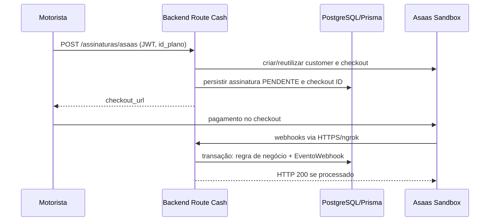
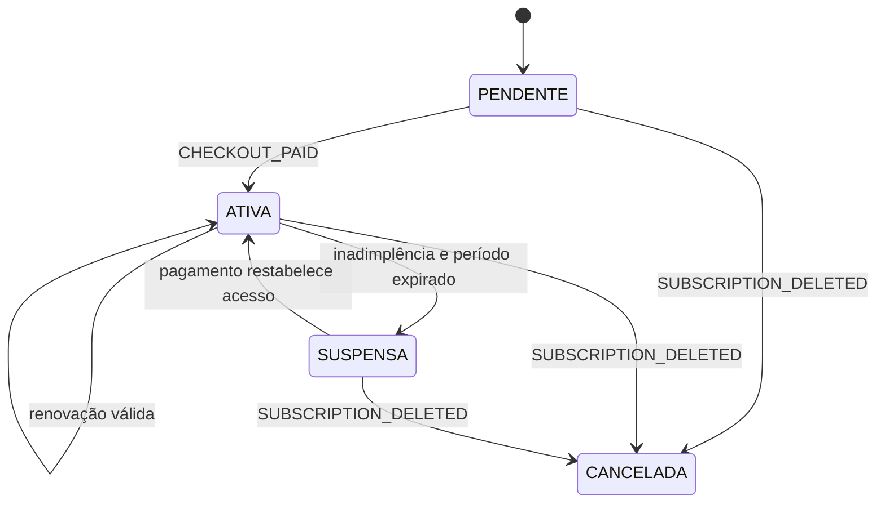

# Route Cash — Relatório técnico da integração Asaas

**Data:** 19 de novembro de 2026  
**Ambiente:** desenvolvimento local e Asaas Sandbox  
**Escopo:** backend, assinaturas recorrentes, cobranças, webhooks e testes de integração  
**Resultado:** ciclo financeiro validado nos cenários executados; produção ainda não homologada.

## 1. Resumo executivo

Nesta sessão foi implementado e validado o ciclo de assinatura recorrente do Route Cash, desde a criação do cliente e checkout até confirmação, renovação, suspensão, reativação e cancelamento. O trabalho evoluiu de testes unitários manuais/simulações de payload para eventos efetivamente emitidos pelo Asaas Sandbox. Foram encontradas duas diferenças críticas entre os payloads previstos e os recebidos: a referência externa não foi propagada à assinatura recorrente no checkout testado, e o evento de criação da cobrança já chegou com status CONFIRMED. Ambas foram tratadas no código; a segunda contratação ocorreu automaticamente, com HTTP 200 nos webhooks e registros corretos no banco.

Este documento registra os resultados relatados durante a sessão, os trechos do service entregue e os pontos de atenção. Não equivale a auditoria independente do banco ou execução de testes automatizados. Os IDs de objetos Sandbox foram mantidos para rastreabilidade; tokens, chaves e dados de cartão foram omitidos.

## 2. Arquitetura e responsabilidade de cada camada

- Backend NestJS: valida requisições, aplica as regras de negócio e controla os estados financeiros.
- Prisma ORM: persistência tipada, busca por identificadores únicos, atualizações condicionais e transações.
- PostgreSQL: guarda usuário, plano, assinatura, pagamento e registro de eventos.
- Asaas Sandbox: cria clientes, sessões de checkout, assinaturas e cobranças recorrentes; emite notificações.
- ngrok: expõe temporariamente a porta local 3000 por HTTPS, permitindo a entrega dos webhooks; seu Inspector permite observar respostas e repetir requisições.
- PowerShell: executa as chamadas de API e as simulações de teste.
- Prisma Studio: permite conferir os estados persistidos após cada operação.
- Web e Flutter: consumidores futuros do estado de assinatura e do acesso premium; a sessão não concluiu essa integração de interface.



A ordem ilustrada representa o fluxo lógico; a entrega real dos eventos pode variar e não deve ser considerada uma garantia.

## 3. Modelo de dados e contratos

| Entidade | Campos utilizados | Responsabilidade |
|---|---|---|
| Usuario | id_usuario, asaas_customer_id, dados cadastrais | Identificar o proprietário local e o cliente externo |
| Plano | id_plano, valor, periodo_cobranca | Definir preço e duração |
| Assinatura | id_assinatura, id_usuario, origem, situacao, asaas_checkout_id, asaas_subscription_id, data_inicio, data_vencimento, data_cancelamento | Controlar contratação e período de acesso |
| Pagamento | id_pagamento, id_assinatura, asaas_payment_id, valor, situacao, data_vencimento, data_pagamento | Registrar cada ciclo financeiro |
| EventoWebhook | id_evento, provedor, tipo, processado_em | Identificar eventos já processados |

As buscas `findUnique` usadas pelo service dependem da unicidade dos identificadores externos correspondentes no schema. O schema completo e a migration não estão anexados a este relatório; não se reproduz DDL não verificado. Durante a sessão foi adicionada a situação CANCELADO ao enum de pagamento, com migration relatada como aplicada. Estornos foram deixados fora do MVP.

### Estados e responsabilidades

| Assinatura | Significado |
|---|---|
| PENDENTE | Checkout criado, aguardando ativação |
| ATIVA | Ativada pelo CHECKOUT_PAID, ou renovada/reativada |
| SUSPENSA | Período expirado e cobrança vencida, conforme regra atual |
| CANCELADA | Cancelamento registrado; preserva datas e histórico |

| Pagamento | Significado |
|---|---|
| PENDENTE | Cobrança registrada sem confirmação local |
| PAGO | Confirmação ou recebimento reconhecido |
| VENCIDO | Cobrança pendente que teve vencimento processado |
| CANCELADO | Cobrança pendente/vencida excluída no provedor |



## 4. Contratação e API local

Rotas efetivamente usadas na sessão:

| Método | Caminho | Autenticação |
|---|---|---|
| POST | /usuarios | Cadastro |
| POST | /autenticacao/login | E-mail e senha |
| GET | /usuarios/me | Bearer JWT |
| PATCH | /usuarios/me | Bearer JWT |
| POST | /assinaturas/asaas | Bearer JWT |
| POST | /webhooks/asaas | `asaas-access-token` |

O checkout é recorrente, por cartão de crédito, e a assinatura local é inicialmente PENDENTE sem datas de acesso e sem subscription ID. O cliente externo é criado/reutilizado com os dados cadastrais. A sessão testou o plano mensal de R$ 19,90 (ID `2852670f-180b-47c1-ab98-84ab8ac0354a`). O checkout retornou a URL de Sandbox, o ID da sessão e o indicador `checkout_reutilizado`. A implementação completa do serviço de contratação não consta no arquivo final de webhooks: a descrição acima é o contrato observado, não uma reprodução literal desse serviço.

```powershell
$login = Invoke-RestMethod -Uri 'http://localhost:3000/autenticacao/login' `
  -Method POST -ContentType 'application/json' `
  -Body (@{ email = $emailTeste; senha = $senhaTeste } | ConvertTo-Json) -ErrorAction Stop
$jwt = $login.access_token
$usuario = Invoke-RestMethod -Uri 'http://localhost:3000/usuarios/me' `
  -Headers @{ Authorization = "Bearer $jwt" } -ErrorAction Stop
$checkout = Invoke-RestMethod -Uri 'http://localhost:3000/assinaturas/asaas' `
  -Method POST -Headers @{ Authorization = "Bearer $jwt" } `
  -ContentType 'application/json' `
  -Body (@{ id_plano = '2852670f-180b-47c1-ab98-84ab8ac0354a' } | ConvertTo-Json) -ErrorAction Stop
```

Pré-requisito: cadastrar os dados necessários ao Customer usando PATCH /usuarios/me (CPF de teste, celular, CEP e endereço). Confirmar o id_usuario antes de criar checkout. Uma tentativa retornou o checkout anterior por reaproveitamento provável de variáveis PowerShell; o novo login e a consulta /usuarios/me eliminaram a confusão. `-ErrorAction Stop` evita continuar o roteiro após falha.

## 5. Implementação do WebhooksService — leitura comentada

Fonte primária: `webhooks.service.atualizado.ts`, versão entregue e compilada pelo usuário; o apêndice contém a íntegra desse arquivo. O método de data foi temporariamente modificado em teste de inadimplência e a restauração foi orientada; conferir o arquivo local antes de commit.

### 5.1. Autenticação e configuração

O token é lido no ConfigService. Um token ausente na configuração resulta em 500; cabeçalho ausente ou inválido resulta em 401. A comparação por bytes com timingSafeEqual evita comparação comum dependente do conteúdo; o tamanho é verificado antes para não lançar exceção. O token do webhook não é a chave da API.

```typescript
export class WebhooksService {
  private readonly webhookToken: string;

  constructor(
    private readonly configService: ConfigService,
    private readonly prisma: PrismaService,
  ) {
    this.webhookToken =
      this.configService
        .get<string>('ASAAS_WEBHOOK_TOKEN')
        ?.trim() ?? '';
  }

  // ==========================================
  // VALIDAÇÃO DO TOKEN
  // ==========================================

  private validarToken(
    tokenRecebido: string | undefined,
  ): void {
    if (!this.webhookToken) {
      throw new InternalServerErrorException(
        'ASAAS_WEBHOOK_TOKEN não está configurado no .env.',
      );
    }

    if (!tokenRecebido) {
      throw new UnauthorizedException(
        'Token do Webhook Asaas não informado.',
      );
    }

    const configurado = Buffer.from(
      this.webhookToken,
      'utf8',
    );

    const recebido = Buffer.from(
      tokenRecebido,
      'utf8',
    );

    const tokenValido =
      configurado.length === recebido.length &&
      timingSafeEqual(configurado, recebido);

    if (!tokenValido) {
      throw new UnauthorizedException(
        'Token do Webhook Asaas inválido.',
      );
    }
  }
```

### 5.2. Validação do envelope

Valida objeto não nulo, id e event textuais, não vazios e limitados em comprimento. Preserva campos adicionais como payment e subscription; validações específicas ocorrem nos handlers. Não utiliza dateCreated como garantia de ordenação.

```typescript
  private validarPayload(
    payload: unknown,
  ): AsaasWebhookPayload {
    if (
      !payload ||
      typeof payload !== 'object' ||
      Array.isArray(payload)
    ) {
      throw new BadRequestException(
        'Payload do Webhook Asaas inválido.',
      );
    }

    const dados = payload as Record<string, unknown>;

    if (
      typeof dados.id !== 'string' ||
      !dados.id.trim()
    ) {
      throw new BadRequestException(
        'O Webhook Asaas não informou um id de evento válido.',
      );
    }

    if (
      typeof dados.event !== 'string' ||
      !dados.event.trim()
    ) {
      throw new BadRequestException(
        'O Webhook Asaas não informou um tipo de evento válido.',
      );
    }

    const id = dados.id.trim();
    const event = dados.event.trim();

    if (id.length > 150) {
      throw new BadRequestException(
        'O id do evento recebido excede o limite suportado.',
      );
    }

    if (event.length > 100) {
      throw new BadRequestException(
        'O tipo do evento recebido excede o limite suportado.',
      );
    }

    return {
      ...dados,
      id,
      event,
      dateCreated:
        typeof dados.dateCreated === 'string'
          ? dados.dateCreated
          : undefined,
    };
  }
```

### 5.3. Datas e calendário

Normaliza o dia civil de São Paulo em meia-noite UTC. A soma mensal/anual é feita por calendário, limitada ao último dia do mês de destino. Exemplo: 31 de janeiro mais um mês não salta para março. Períodos não suportados geram erro. Essa regra não equivale a adicionar 30 dias.

```typescript
  private obterDataAtual(): Date {
    const partes = new Intl.DateTimeFormat('en-CA', {
      timeZone: 'America/Sao_Paulo',
      year: 'numeric',
      month: '2-digit',
      day: '2-digit',
    }).formatToParts(new Date());

    const ano = Number(
      partes.find((p) => p.type === 'year')?.value,
    );

    const mes = Number(
      partes.find((p) => p.type === 'month')?.value,
    );

    const dia = Number(
      partes.find((p) => p.type === 'day')?.value,
    );

    return new Date(Date.UTC(ano, mes - 1, dia));
  }

  // ==========================================
  // CÁLCULO DO VENCIMENTO
  // ==========================================

  private calcularDataVencimento(
    dataInicio: Date,
    periodoCobranca: string,
  ): Date {
    const periodo =
      periodoCobranca.trim().toUpperCase();

    let meses: number;

    switch (periodo) {
      case 'MENSAL':
        meses = 1;
        break;

      case 'ANUAL':
        meses = 12;
        break;

      default:
        throw new InternalServerErrorException(
          `Período de cobrança não suportado: ${periodoCobranca}`,
        );
    }

    const ano = dataInicio.getUTCFullYear();
    const mes = dataInicio.getUTCMonth();
    const dia = dataInicio.getUTCDate();

    // Identifica o último dia do mês de destino.
    // Evita que 31/01 + 1 mês resulte em março.
    const ultimoDiaMes = new Date(
      Date.UTC(ano, mes + meses + 1, 0),
    ).getUTCDate();

    return new Date(
      Date.UTC(
        ano,
        mes + meses,
        Math.min(dia, ultimoDiaMes),
      ),
    );
  }
```

### 5.4. Ativação — CHECKOUT_PAID

Busca pelo checkout, exige origem ASAAS e estado PENDENTE. A atualização condicional evita ativação repetida; assinaturas ATIVA, SUSPENSA ou CANCELADA não são reativadas pelo checkout. Calcula o primeiro período usando a data de processamento. Em entregas atrasadas isso pode divergir da data efetiva do pagamento; melhoria futura deve usar uma referência de ciclo confiável.

```typescript
  private async processarCheckoutPaid(
    tx: Prisma.TransactionClient,
    payload: AsaasWebhookPayload,
  ) {
    const checkout = payload.checkout;

    if (
      !checkout ||
      typeof checkout !== 'object' ||
      Array.isArray(checkout)
    ) {
      throw new BadRequestException(
        'O evento CHECKOUT_PAID não informou o checkout.',
      );
    }

    const dadosCheckout =
      checkout as Record<string, unknown>;

    if (
      typeof dadosCheckout.id !== 'string' ||
      !dadosCheckout.id.trim() ||
      dadosCheckout.id.trim().length > 100
    ) {
      throw new BadRequestException(
        'O evento CHECKOUT_PAID não informou um checkout.id válido.',
      );
    }

    const checkoutId = dadosCheckout.id.trim();

    // Localiza a assinatura vinculada ao checkout.
    const assinatura = await tx.assinatura.findUnique({
      where: {
        asaas_checkout_id: checkoutId,
      },
      include: {
        plano: true,
      },
    });

    if (!assinatura || assinatura.origem !== 'ASAAS') {
      throw new NotFoundException(
        `Assinatura Asaas não encontrada para o checkout ${checkoutId}.`,
      );
    }

    // Não altera assinaturas que já foram ativadas,
    // suspensas ou canceladas.
    if (assinatura.situacao !== 'PENDENTE') {
      return {
        assinatura_ativada: false,
        id_assinatura: assinatura.id_assinatura,
        situacao: assinatura.situacao,
        mensagem:
          'Assinatura não está pendente. Nenhuma alteração realizada.',
      };
    }

    const dataInicio = this.obterDataAtual();

    const dataVencimento =
      this.calcularDataVencimento(
        dataInicio,
        assinatura.plano.periodo_cobranca,
      );

    // Atualização condicional para impedir que dois
    // eventos simultâneos ativem a mesma assinatura.
    const resultado = await tx.assinatura.updateMany({
      where: {
        id_assinatura: assinatura.id_assinatura,
        situacao: 'PENDENTE',
        origem: 'ASAAS',
      },
      data: {
        situacao: 'ATIVA',
        data_inicio: dataInicio,
        data_vencimento: dataVencimento,
      },
    });

    if (resultado.count === 0) {
      const atual = await tx.assinatura.findUnique({
        where: {
          id_assinatura: assinatura.id_assinatura,
        },
      });

      return {
        assinatura_ativada: false,
        id_assinatura: assinatura.id_assinatura,
        situacao: atual?.situacao,
        mensagem:
          'A assinatura já foi alterada por outro processamento.',
      };
    }

    return {
      assinatura_ativada: true,
      id_assinatura: assinatura.id_assinatura,
      situacao: 'ATIVA',
      data_inicio: dataInicio,
      data_vencimento: dataVencimento,
      mensagem: 'Assinatura ativada com sucesso.',
    };
  }
```

### 5.5. Vinculação — SUBSCRIPTION_CREATED

O handler valida id, customer, checkout e referência externa quando informada. Primeiro busca o subscription ID; depois o checkout; finalmente a referência externa. Confere proprietário, origem e consistência dos identificadores. O vínculo já existente é tratado como sucesso sem mudança. A atualização só preenche vínculo nulo e relê em caso de concorrência.

```typescript
private async processarSubscriptionCreated(
  tx: Prisma.TransactionClient,
  payload: AsaasWebhookPayload,
) {
  const subscription = payload.subscription;

  if (
    !subscription ||
    typeof subscription !== 'object' ||
    Array.isArray(subscription)
  ) {
    throw new BadRequestException(
      'O evento SUBSCRIPTION_CREATED não informou a assinatura.',
    );
  }

  const dadosSubscription =
    subscription as Record<string, unknown>;

  // Valida o ID da assinatura Asaas.
  if (
    typeof dadosSubscription.id !== 'string' ||
    !dadosSubscription.id.trim() ||
    dadosSubscription.id.trim().length > 100
  ) {
    throw new BadRequestException(
      'O evento não informou um subscription.id válido.',
    );
  }

  const subscriptionId =
    dadosSubscription.id.trim();

  // Valida o Customer.
  if (
    typeof dadosSubscription.customer !== 'string' ||
    !dadosSubscription.customer.trim()
  ) {
    throw new BadRequestException(
      'O evento não informou um Customer válido.',
    );
  }

  const customerId =
    dadosSubscription.customer.trim();

  // Obtém o ID do Checkout.
  const checkoutId =
    typeof dadosSubscription.checkoutSession === 'string'
      ? dadosSubscription.checkoutSession.trim()
      : null;

  // Obtém a referência externa, quando existir.
  const externalReference =
    typeof dadosSubscription.externalReference === 'string'
      ? dadosSubscription.externalReference.trim()
      : null;

  const uuidValido =
    /^[0-9a-f]{8}-[0-9a-f]{4}-[0-9a-f]{4}-[0-9a-f]{4}-[0-9a-f]{12}$/i;

  if (
    externalReference &&
    !uuidValido.test(externalReference)
  ) {
    throw new BadRequestException(
      'Referência externa inválida.',
    );
  }

  // ==========================================
  // 1. BUSCAR PELO SUBSCRIPTION ID
  // ==========================================

  let assinatura = await tx.assinatura.findUnique({
    where: {
      asaas_subscription_id: subscriptionId,
    },
    include: {
      usuario: true,
    },
  });

  // ==========================================
  // 2. BUSCAR PELO CHECKOUT SESSION
  // ==========================================

  if (!assinatura && checkoutId) {
    assinatura = await tx.assinatura.findUnique({
      where: {
        asaas_checkout_id: checkoutId,
      },
      include: {
        usuario: true,
      },
    });
  }

  // ==========================================
  // 3. BUSCAR PELA REFERÊNCIA EXTERNA
  // ==========================================

  if (!assinatura && externalReference) {
    assinatura = await tx.assinatura.findUnique({
      where: {
        id_assinatura: externalReference,
      },
      include: {
        usuario: true,
      },
    });
  }

  // ==========================================
  // VALIDAR A ASSINATURA LOCALIZADA
  // ==========================================

  if (!assinatura || assinatura.origem !== 'ASAAS') {
    throw new NotFoundException(
      'Assinatura interna do Asaas não encontrada.',
    );
  }

  // Valida o proprietário da assinatura.
  if (
    assinatura.usuario.asaas_customer_id !== customerId
  ) {
    throw new ConflictException(
      'O Customer recebido não corresponde à assinatura.',
    );
  }

  // Valida a compatibilidade do Checkout.
  if (
    checkoutId &&
    assinatura.asaas_checkout_id !== checkoutId
  ) {
    throw new ConflictException(
      'O Checkout informado não corresponde à assinatura.',
    );
  }

  // Valida a referência externa, quando informada.
  if (
    externalReference &&
    assinatura.id_assinatura !== externalReference
  ) {
    throw new ConflictException(
      'Referência externa incompatível com a assinatura.',
    );
  }

  // Impede a substituição de um vínculo existente.
  if (
    assinatura.asaas_subscription_id &&
    assinatura.asaas_subscription_id !== subscriptionId
  ) {
    throw new ConflictException(
      'A assinatura já possui outro vínculo com o Asaas.',
    );
  }

  // Assinatura já vinculada corretamente.
  if (
    assinatura.asaas_subscription_id === subscriptionId
  ) {
    return {
      assinatura_vinculada: false,
      id_assinatura: assinatura.id_assinatura,
      asaas_subscription_id: subscriptionId,
      mensagem:
        'Assinatura Asaas já vinculada anteriormente.',
    };
  }

  // ==========================================
  // VINCULAR ASSINATURA
  // ==========================================

  const resultado = await tx.assinatura.updateMany({
    where: {
      id_assinatura: assinatura.id_assinatura,
      asaas_subscription_id: null,
      origem: 'ASAAS',
    },
    data: {
      asaas_subscription_id: subscriptionId,
    },
  });

  if (resultado.count === 0) {
    const atual = await tx.assinatura.findUnique({
      where: {
        id_assinatura: assinatura.id_assinatura,
      },
    });

    if (
      atual?.asaas_subscription_id === subscriptionId
    ) {
      return {
        assinatura_vinculada: false,
        id_assinatura: assinatura.id_assinatura,
        asaas_subscription_id: subscriptionId,
        mensagem:
          'Assinatura já vinculada por outro processamento.',
      };
    }

    throw new ConflictException(
      'Não foi possível vincular a assinatura Asaas.',
    );
  }

  return {
    assinatura_vinculada: true,
    id_assinatura: assinatura.id_assinatura,
    asaas_subscription_id: subscriptionId,
    asaas_checkout_id: assinatura.asaas_checkout_id,
    situacao: assinatura.situacao,
    mensagem:
      'Assinatura Asaas vinculada com sucesso.',
  };
}
```

### 5.6. Registro — PAYMENT_CREATED

Ignora cobranças sem assinatura recorrente. Valida identificadores, valor decimal positivo e vencimento ISO, inclusive coerência do dia. Busca pelo subscription ID ou pelo checkoutSession. Impede troca indevida de vínculo, confirma o Customer e relê após updateMany. Preserva cobranças existentes; upsert evita sobrescrever seu estado. A confirmação imediata ocorre no dispatcher, não neste método. Em concorrência, o upsert protege unicidade, mas o indicador pagamento_criado pode não distinguir uma inserção concorrente.

```typescript
private async processarPaymentCreated(
  tx: Prisma.TransactionClient,
  payload: AsaasWebhookPayload,
) {
  const payment = payload.payment;

  // Valida o objeto da cobrança.
  if (
    !payment ||
    typeof payment !== 'object' ||
    Array.isArray(payment)
  ) {
    throw new BadRequestException(
      'O evento PAYMENT_CREATED não informou a cobrança.',
    );
  }

  const dadosPayment =
    payment as Record<string, unknown>;

  // Valida o ID da cobrança no Asaas.
  if (
    typeof dadosPayment.id !== 'string' ||
    !dadosPayment.id.trim() ||
    dadosPayment.id.trim().length > 100
  ) {
    throw new BadRequestException(
      'O evento não informou um payment.id válido.',
    );
  }

  const paymentId = dadosPayment.id.trim();

  // Cobranças que não pertencem a uma assinatura
  // não fazem parte do fluxo recorrente do Route Cash.
  if (
    dadosPayment.subscription === null ||
    dadosPayment.subscription === undefined
  ) {
    return {
      pagamento_criado: false,
      mensagem:
        'Cobrança sem assinatura recorrente ignorada.',
    };
  }

  if (
    typeof dadosPayment.subscription !== 'string' ||
    !dadosPayment.subscription.trim()
  ) {
    throw new BadRequestException(
      'O evento não informou uma assinatura válida.',
    );
  }

  const subscriptionId =
    dadosPayment.subscription.trim();

  // Valida o Customer da cobrança.
  if (
    typeof dadosPayment.customer !== 'string' ||
    !dadosPayment.customer.trim()
  ) {
    throw new BadRequestException(
      'O evento não informou um Customer válido.',
    );
  }

  const customerId =
    dadosPayment.customer.trim();

  // Valida o valor da cobrança.
  if (
    typeof dadosPayment.value !== 'number' ||
    !Number.isFinite(dadosPayment.value) ||
    dadosPayment.value <= 0
  ) {
    throw new BadRequestException(
      'O evento não informou um valor válido.',
    );
  }

  const valor = new Prisma.Decimal(
    dadosPayment.value,
  );

  if (
    valor.decimalPlaces() > 2 ||
    valor.greaterThan('9999999999.99')
  ) {
    throw new BadRequestException(
      'O valor excede a precisão suportada.',
    );
  }

  // Valida a data de vencimento.
  if (
    typeof dadosPayment.dueDate !== 'string' ||
    !/^\d{4}-\d{2}-\d{2}$/.test(
      dadosPayment.dueDate,
    )
  ) {
    throw new BadRequestException(
      'O evento não informou um vencimento válido.',
    );
  }

  const dataVencimento = new Date(
    `${dadosPayment.dueDate}T00:00:00.000Z`,
  );

  if (
    Number.isNaN(dataVencimento.getTime()) ||
    dataVencimento.toISOString().slice(0, 10) !==
      dadosPayment.dueDate
  ) {
    throw new BadRequestException(
      'Data de vencimento inválida.',
    );
  }

  // O checkout permite vincular a assinatura mesmo quando
  // PAYMENT_CREATED chega antes de SUBSCRIPTION_CREATED.
  const checkoutId =
    typeof dadosPayment.checkoutSession === 'string'
      ? dadosPayment.checkoutSession.trim() || null
      : null;

  if (checkoutId && checkoutId.length > 100) {
    throw new BadRequestException('Checkout inválido.');
  }

  let assinatura = await tx.assinatura.findUnique({
    where: { asaas_subscription_id: subscriptionId },
    include: { usuario: true },
  });

  if (!assinatura && checkoutId) {
    assinatura = await tx.assinatura.findUnique({
      where: { asaas_checkout_id: checkoutId },
      include: { usuario: true },
    });
  }

  if (!assinatura || assinatura.origem !== 'ASAAS') {
    throw new NotFoundException(
      'Assinatura vinculada à cobrança não encontrada.',
    );
  }

  if (assinatura.usuario.asaas_customer_id !== customerId) {
    throw new ConflictException(
      'O Customer da cobrança não corresponde ao usuário da assinatura.',
    );
  }

  if (checkoutId && assinatura.asaas_checkout_id !== checkoutId) {
    throw new ConflictException(
      'O Checkout da cobrança não corresponde à assinatura.',
    );
  }

  if (assinatura.asaas_subscription_id &&
      assinatura.asaas_subscription_id !== subscriptionId) {
    throw new ConflictException(
      'A assinatura já possui outro vínculo com o Asaas.',
    );
  }

  if (!assinatura.asaas_subscription_id) {
    if (!checkoutId) {
      throw new BadRequestException('Checkout não informado para vinculação.');
    }
    await tx.assinatura.updateMany({
      where: {
        id_assinatura: assinatura.id_assinatura,
        origem: 'ASAAS',
        asaas_checkout_id: checkoutId,
        asaas_subscription_id: null,
      },
      data: { asaas_subscription_id: subscriptionId },
    });

    // Confere também se outro processamento vinculou a assinatura.
    const atual = await tx.assinatura.findUniqueOrThrow({
      where: { id_assinatura: assinatura.id_assinatura },
      include: { usuario: true },
    });

    if (atual.asaas_subscription_id !== subscriptionId ||
        atual.usuario.asaas_customer_id !== customerId ||
        atual.asaas_checkout_id !== checkoutId ||
        atual.origem !== 'ASAAS') {
      throw new ConflictException(
        'Não foi possível vincular a assinatura da cobrança.',
      );
    }

    assinatura = atual;
  }

  // Verifica se a cobrança já existe.
  const existente = await tx.pagamento.findUnique({
    where: {
      asaas_payment_id: paymentId,
    },
  });

  if (existente) {
    if (
      existente.id_assinatura !== assinatura.id_assinatura
    ) {
      throw new ConflictException(
        'A cobrança já está vinculada a outra assinatura.',
      );
    }

    return {
      pagamento_criado: false,
      id_pagamento: existente.id_pagamento,
      asaas_payment_id: paymentId,
      situacao: existente.situacao,
      mensagem:
        'Cobrança já registrada anteriormente.',
    };
  }

  // Registra a cobrança sem sobrescrever uma existente.
  const pagamento = await tx.pagamento.upsert({
    where: {
      asaas_payment_id: paymentId,
    },
    update: {},
    create: {
      id_assinatura: assinatura.id_assinatura,
      asaas_payment_id: paymentId,
      valor,
      data_vencimento: dataVencimento,
      data_pagamento: null,
      situacao: 'PENDENTE',
    },
  });

  if (
    pagamento.id_assinatura !== assinatura.id_assinatura
  ) {
    throw new ConflictException(
      'A cobrança possui um vínculo incompatível.',
    );
  }

  return {
    pagamento_criado: true,
    id_pagamento: pagamento.id_pagamento,
    id_assinatura: pagamento.id_assinatura,
    asaas_payment_id: pagamento.asaas_payment_id,
    valor: pagamento.valor,
    situacao: pagamento.situacao,
    data_vencimento: pagamento.data_vencimento,
    mensagem: 'Cobrança registrada com sucesso.',
  };
}
```

### 5.7. Renovação e reativação

Somente assinaturas ASAAS ATIVA ou SUSPENSA com vencimento podem renovar. Se a data da cobrança é anterior ao vencimento vigente, aquele ciclo já está contemplado. Caso contrário, soma o período ao vencimento da cobrança, não à data da confirmação. Isso permite antecipar cobranças sem perder dias de acesso. Atualização condicional impede extensão repetida; uma cobrança antiga que não restabelece acesso válido não reativa uma assinatura suspensa. Regra pressupõe continuidade dos ciclos: pagar um ciclo posterior com anteriores em aberto merece validação adicional.

```typescript
private async renovarAssinatura(
  tx: Prisma.TransactionClient,
  assinaturaId: string,
  dataVencimentoCobranca: Date,
) {
  const assinatura = await tx.assinatura.findUnique({
    where: {
      id_assinatura: assinaturaId,
    },
    include: {
      plano: true,
    },
  });

  if (!assinatura) {
    throw new NotFoundException(
      'Assinatura não encontrada para renovação.',
    );
  }

  // Somente assinaturas ASAAS ativas ou suspensas
  // podem ser renovadas.
  if (
    assinatura.origem !== 'ASAAS' ||
    !['ATIVA', 'SUSPENSA'].includes(
      assinatura.situacao,
    ) ||
    !assinatura.data_vencimento
  ) {
    return {
      assinatura_renovada: false,
      assinatura_reativada: false,
      mensagem:
        'Assinatura não está apta para renovação.',
    };
  }

  // Ignora cobranças de ciclos anteriores.
  if (
    dataVencimentoCobranca.getTime() <
    assinatura.data_vencimento.getTime()
  ) {
    return {
      assinatura_renovada: false,
      assinatura_reativada: false,
      data_vencimento: assinatura.data_vencimento,
      mensagem:
        'Ciclo da cobrança já contemplado pela assinatura.',
    };
  }

  const novoVencimento =
    this.calcularDataVencimento(
      dataVencimentoCobranca,
      assinatura.plano.periodo_cobranca,
    );

  const hoje = this.obterDataAtual();

  // Um pagamento antigo não deve reativar
  // uma assinatura cujo novo período já expirou.
  if (
    assinatura.situacao === 'SUSPENSA' &&
    novoVencimento.getTime() < hoje.getTime()
  ) {
    return {
      assinatura_renovada: false,
      assinatura_reativada: false,
      mensagem:
        'O pagamento não restabelece um período de acesso válido.',
    };
  }

  const reativacao =
    assinatura.situacao === 'SUSPENSA';

  // Atualização condicional para evitar
  // alterações concorrentes e duplicadas.
  const resultado = await tx.assinatura.updateMany({
    where: {
      id_assinatura: assinaturaId,
      origem: 'ASAAS',
      situacao: assinatura.situacao,
      data_vencimento: {
        lte: dataVencimentoCobranca,
        lt: novoVencimento,
      },
    },
    data: {
      data_vencimento: novoVencimento,
      situacao: 'ATIVA',
    },
  });

  if (resultado.count === 0) {
    return {
      assinatura_renovada: false,
      assinatura_reativada: false,
      mensagem:
        'Ciclo já renovado ou assinatura alterada.',
    };
  }
```

### 5.8. Confirmação — PAYMENT_CONFIRMED / PAYMENT_RECEIVED

Localiza pagamento já registrado e confere assinatura e Customer. Prioriza paymentDate, usa confirmedDate como alternativa, valida data e muda PENDENTE/VENCIDO para PAGO. Pagamento já pago não é alterado. Pagamento CANCELADO não passa pelo filtro de atualização. A renovação é chamada na mesma transação. Se a confirmação chegar antes da criação da cobrança, este método ainda responde 404: precisa de retry ou reconciliação adicional.

```typescript
private async processarPaymentConfirmed(
  tx: Prisma.TransactionClient,
  payload: AsaasWebhookPayload,
) {
  const payment = payload.payment;

  // Valida o objeto da cobrança.
  if (
    !payment ||
    typeof payment !== 'object' ||
    Array.isArray(payment)
  ) {
    throw new BadRequestException(
      'O evento não informou a cobrança.',
    );
  }

  const dadosPayment =
    payment as Record<string, unknown>;

  // Valida o identificador da cobrança.
  if (
    typeof dadosPayment.id !== 'string' ||
    !dadosPayment.id.trim() ||
    dadosPayment.id.trim().length > 100
  ) {
    throw new BadRequestException(
      'O evento não informou um payment.id válido.',
    );
  }

  const paymentId = dadosPayment.id.trim();

  // Ignora cobranças sem assinatura recorrente.
  if (
    dadosPayment.subscription === null ||
    dadosPayment.subscription === undefined
  ) {
    return {
      pagamento_confirmado: false,
      mensagem:
        'Cobrança sem assinatura recorrente ignorada.',
    };
  }

  if (
    typeof dadosPayment.subscription !== 'string' ||
    !dadosPayment.subscription.trim()
  ) {
    throw new BadRequestException(
      'O evento não informou uma assinatura válida.',
    );
  }

  const subscriptionId =
    dadosPayment.subscription.trim();

  // Valida o Customer.
  if (
    typeof dadosPayment.customer !== 'string' ||
    !dadosPayment.customer.trim()
  ) {
    throw new BadRequestException(
      'O evento não informou um Customer válido.',
    );
  }

  const customerId = dadosPayment.customer.trim();

  // Localiza a cobrança e seus relacionamentos.
  const pagamento = await tx.pagamento.findUnique({
    where: {
      asaas_payment_id: paymentId,
    },
    include: {
      assinatura: {
        include: {
          usuario: true,
        },
      },
    },
  });

  if (!pagamento) {
    throw new NotFoundException(
      'Pagamento Asaas não encontrado.',
    );
  }

  // Valida o vínculo com a assinatura.
  if (
    pagamento.assinatura.origem !== 'ASAAS' ||
    pagamento.assinatura.asaas_subscription_id !==
      subscriptionId
  ) {
    throw new ConflictException(
      'O pagamento não pertence à assinatura informada.',
    );
  }

  // Valida o proprietário da cobrança.
  if (
    pagamento.assinatura.usuario.asaas_customer_id !==
      customerId
  ) {
    throw new ConflictException(
      'O Customer informado não corresponde ao pagamento.',
    );
  }

  // Se já estiver pago, não altera novamente.
  if (pagamento.situacao === 'PAGO') {
    return {
      pagamento_confirmado: false,
      id_pagamento: pagamento.id_pagamento,
      asaas_payment_id: paymentId,
      situacao: pagamento.situacao,
      data_pagamento: pagamento.data_pagamento,
      mensagem:
        'Pagamento já confirmado anteriormente.',
    };
  }

  // Obtém a data efetiva do pagamento.
  // Prioriza paymentDate e utiliza confirmedDate
  // quando a primeira não estiver disponível.
  const dataInformada =
    dadosPayment.paymentDate ??
    dadosPayment.confirmedDate;

  if (
    typeof dataInformada !== 'string' ||
    !/^\d{4}-\d{2}-\d{2}$/.test(dataInformada)
  ) {
    throw new BadRequestException(
      'O evento não informou uma data de pagamento válida.',
    );
  }

  const dataPagamento = new Date(
    `${dataInformada}T00:00:00.000Z`,
  );

  if (
    Number.isNaN(dataPagamento.getTime()) ||
    dataPagamento.toISOString().slice(0, 10) !==
      dataInformada
  ) {
    throw new BadRequestException(
      'Data de pagamento inválida.',
    );
  }

  // Atualiza somente pagamentos ainda não pagos.
  const resultado = await tx.pagamento.updateMany({
    where: {
      id_pagamento: pagamento.id_pagamento,
      situacao: {
        in: ['PENDENTE', 'VENCIDO'],
      },
    },
    data: {
      situacao: 'PAGO',
      data_pagamento: dataPagamento,
    },
  });

  if (resultado.count === 0) {
    const atual = await tx.pagamento.findUnique({
      where: {
        id_pagamento: pagamento.id_pagamento,
      },
    });

    return {
      pagamento_confirmado: false,
      id_pagamento: pagamento.id_pagamento,
      situacao: atual?.situacao,
      data_pagamento: atual?.data_pagamento,
      mensagem:
        'Pagamento já alterado por outro processamento.',
    };
  }
```

### 5.9. Inadimplência — PAYMENT_OVERDUE

Ignora cobranças já pagas. Exige vencimento anterior ao dia simulado/atual. Atualiza somente PENDENTE para VENCIDO; só suspende assinatura ATIVA cujo período de acesso também terminou. A cobrança vencida não altera o vencimento da assinatura. Não há suspensão antecipada quando ainda existe período pago.

```typescript
private async processarPaymentOverdue(
  tx: Prisma.TransactionClient,
  payload: AsaasWebhookPayload,
) {
  const payment = payload.payment;

  if (
    !payment ||
    typeof payment !== 'object' ||
    Array.isArray(payment)
  ) {
    throw new BadRequestException(
      'O evento não informou a cobrança.',
    );
  }

  const dadosPayment =
    payment as Record<string, unknown>;

  // Valida o identificador da cobrança.
  if (
    typeof dadosPayment.id !== 'string' ||
    !dadosPayment.id.trim() ||
    dadosPayment.id.trim().length > 100
  ) {
    throw new BadRequestException(
      'O evento não informou um payment.id válido.',
    );
  }

  const paymentId = dadosPayment.id.trim();

  // Ignora cobranças sem assinatura recorrente.
  if (
    dadosPayment.subscription === null ||
    dadosPayment.subscription === undefined
  ) {
    return {
      pagamento_vencido: false,
      mensagem:
        'Cobrança sem assinatura recorrente ignorada.',
    };
  }

  if (
    typeof dadosPayment.subscription !== 'string' ||
    !dadosPayment.subscription.trim()
  ) {
    throw new BadRequestException(
      'O evento não informou uma assinatura válida.',
    );
  }

  const subscriptionId =
    dadosPayment.subscription.trim();

  if (
    typeof dadosPayment.customer !== 'string' ||
    !dadosPayment.customer.trim()
  ) {
    throw new BadRequestException(
      'O evento não informou um Customer válido.',
    );
  }

  const customerId = dadosPayment.customer.trim();

  // Localiza o pagamento.
  const pagamento = await tx.pagamento.findUnique({
    where: {
      asaas_payment_id: paymentId,
    },
    include: {
      assinatura: {
        include: {
          usuario: true,
        },
      },
    },
  });

  if (!pagamento) {
    throw new NotFoundException(
      'Pagamento Asaas não encontrado.',
    );
  }

  // Valida o vínculo com a assinatura.
  if (
    pagamento.assinatura.origem !== 'ASAAS' ||
    pagamento.assinatura.asaas_subscription_id !==
      subscriptionId
  ) {
    throw new ConflictException(
      'O pagamento não pertence à assinatura informada.',
    );
  }

  // Valida o Customer.
  if (
    pagamento.assinatura.usuario.asaas_customer_id !==
      customerId
  ) {
    throw new ConflictException(
      'O Customer informado não corresponde ao pagamento.',
    );
  }

  // Eventos atrasados não podem alterar
  // pagamentos que já foram confirmados.
  if (pagamento.situacao === 'PAGO') {
    return {
      pagamento_vencido: false,
      assinatura_suspensa: false,
      situacao: 'PAGO',
      mensagem:
        'Pagamento já confirmado. Evento ignorado.',
    };
  }

  const hoje = this.obterDataAtual();

  if (
    pagamento.data_vencimento.getTime() >=
    hoje.getTime()
  ) {
    throw new BadRequestException(
      'A data de vencimento da cobrança ainda não passou.',
    );
  }

  // Atualiza somente pagamentos pendentes.
  const resultado = await tx.pagamento.updateMany({
    where: {
      id_pagamento: pagamento.id_pagamento,
      situacao: 'PENDENTE',
    },
    data: {
      situacao: 'VENCIDO',
    },
  });

  const pagamentoAtual =
    await tx.pagamento.findUniqueOrThrow({
      where: {
        id_pagamento: pagamento.id_pagamento,
      },
    });

  if (pagamentoAtual.situacao !== 'VENCIDO') {
    return {
      pagamento_vencido: false,
      assinatura_suspensa: false,
      situacao: pagamentoAtual.situacao,
      mensagem:
        'Pagamento alterado por outro processamento.',
    };
  }
```

### 5.10. Cancelamento da assinatura

Valida vínculo e Customer, preserva datas e pagamentos anteriores, grava CANCELADA e data_cancelamento. Repetição de cancelamento não altera novamente. A política de acesso até o fim do período pago deve ser definida separadamente; o estado sozinho não determina automaticamente o comportamento de todos os endpoints.

```typescript
private async processarSubscriptionDeleted(
  tx: Prisma.TransactionClient,
  payload: AsaasWebhookPayload,
) {
  const subscription = payload.subscription;

  // Valida o objeto da assinatura.
  if (
    !subscription ||
    typeof subscription !== 'object' ||
    Array.isArray(subscription)
  ) {
    throw new BadRequestException(
      'O evento não informou a assinatura.',
    );
  }

  const dadosSubscription =
    subscription as Record<string, unknown>;

  // Valida o identificador da assinatura Asaas.
  if (
    typeof dadosSubscription.id !== 'string' ||
    !dadosSubscription.id.trim() ||
    dadosSubscription.id.trim().length > 100
  ) {
    throw new BadRequestException(
      'O evento não informou um subscription.id válido.',
    );
  }

  const subscriptionId =
    dadosSubscription.id.trim();

  // Valida o Customer.
  if (
    typeof dadosSubscription.customer !== 'string' ||
    !dadosSubscription.customer.trim()
  ) {
    throw new BadRequestException(
      'O evento não informou um Customer válido.',
    );
  }

  const customerId =
    dadosSubscription.customer.trim();

  // Localiza a assinatura interna.
  const assinatura = await tx.assinatura.findUnique({
    where: {
      asaas_subscription_id: subscriptionId,
    },
    include: {
      usuario: true,
    },
  });

  if (!assinatura || assinatura.origem !== 'ASAAS') {
    throw new NotFoundException(
      'Assinatura Asaas não encontrada.',
    );
  }

  // Confirma o proprietário da assinatura.
  if (
    assinatura.usuario.asaas_customer_id !== customerId
  ) {
    throw new ConflictException(
      'O Customer informado não corresponde à assinatura.',
    );
  }

  // Evita cancelar novamente uma assinatura
  // que já foi cancelada anteriormente.
  if (assinatura.situacao === 'CANCELADA') {
    return {
      assinatura_cancelada: false,
      id_assinatura: assinatura.id_assinatura,
      situacao: assinatura.situacao,
      data_cancelamento: assinatura.data_cancelamento,
      mensagem:
        'Assinatura já cancelada anteriormente.',
    };
  }

  const dataCancelamento = new Date();

  // Atualiza somente assinaturas ainda não canceladas.
  const resultado = await tx.assinatura.updateMany({
    where: {
      id_assinatura: assinatura.id_assinatura,
      origem: 'ASAAS',
      situacao: {
        in: ['ATIVA', 'SUSPENSA', 'PENDENTE'],
      },
    },
    data: {
      situacao: 'CANCELADA',
      data_cancelamento: dataCancelamento,
    },
  });

  if (resultado.count === 0) {
    return {
      assinatura_cancelada: false,
      id_assinatura: assinatura.id_assinatura,
      mensagem:
        'Assinatura já alterada por outro processamento.',
    };
  }
```

### 5.11. Cancelamento de cobrança

Valida associação e preserva PAGO e CANCELADO. Altera apenas PENDENTE ou VENCIDO para CANCELADO. Não estorna valores nem modifica diretamente a assinatura; o histórico permanece.

```typescript
private async processarPaymentDeleted(
  tx: Prisma.TransactionClient,
  payload: AsaasWebhookPayload,
) {
  const payment = payload.payment;

  // Valida o objeto da cobrança.
  if (
    !payment ||
    typeof payment !== 'object' ||
    Array.isArray(payment)
  ) {
    throw new BadRequestException(
      'O evento não informou a cobrança.',
    );
  }

  const dadosPayment =
    payment as Record<string, unknown>;

  // Valida o ID da cobrança.
  if (
    typeof dadosPayment.id !== 'string' ||
    !dadosPayment.id.trim() ||
    dadosPayment.id.trim().length > 100
  ) {
    throw new BadRequestException(
      'O evento não informou um payment.id válido.',
    );
  }

  const paymentId = dadosPayment.id.trim();

  // Ignora cobranças sem assinatura recorrente.
  if (
    dadosPayment.subscription === null ||
    dadosPayment.subscription === undefined
  ) {
    return {
      pagamento_cancelado: false,
      mensagem:
        'Cobrança sem assinatura recorrente ignorada.',
    };
  }

  if (
    typeof dadosPayment.subscription !== 'string' ||
    !dadosPayment.subscription.trim()
  ) {
    throw new BadRequestException(
      'O evento não informou uma assinatura válida.',
    );
  }

  const subscriptionId =
    dadosPayment.subscription.trim();

  // Valida o Customer.
  if (
    typeof dadosPayment.customer !== 'string' ||
    !dadosPayment.customer.trim()
  ) {
    throw new BadRequestException(
      'O evento não informou um Customer válido.',
    );
  }

  const customerId = dadosPayment.customer.trim();

  // Localiza o pagamento.
  const pagamento = await tx.pagamento.findUnique({
    where: {
      asaas_payment_id: paymentId,
    },
    include: {
      assinatura: {
        include: {
          usuario: true,
        },
      },
    },
  });

  if (!pagamento) {
    throw new NotFoundException(
      'Pagamento Asaas não encontrado.',
    );
  }

  // Valida o vínculo com a assinatura.
  if (
    pagamento.assinatura.origem !== 'ASAAS' ||
    pagamento.assinatura.asaas_subscription_id !==
      subscriptionId
  ) {
    throw new ConflictException(
      'O pagamento não pertence à assinatura informada.',
    );
  }

  // Valida o proprietário da cobrança.
  if (
    pagamento.assinatura.usuario.asaas_customer_id !==
      customerId
  ) {
    throw new ConflictException(
      'O Customer informado não corresponde ao pagamento.',
    );
  }

  // Preserva pagamentos já confirmados.
  if (pagamento.situacao === 'PAGO') {
    return {
      pagamento_cancelado: false,
      id_pagamento: pagamento.id_pagamento,
      situacao: 'PAGO',
      mensagem:
        'Pagamento já confirmado. Evento ignorado.',
    };
  }

  // Impede cancelamento repetido.
  if (pagamento.situacao === 'CANCELADO') {
    return {
      pagamento_cancelado: false,
      id_pagamento: pagamento.id_pagamento,
      situacao: 'CANCELADO',
      mensagem:
        'Pagamento já cancelado anteriormente.',
    };
  }

  // Cancela somente pagamentos pendentes ou vencidos.
  const resultado = await tx.pagamento.updateMany({
    where: {
      id_pagamento: pagamento.id_pagamento,
      situacao: {
        in: ['PENDENTE', 'VENCIDO'],
      },
    },
    data: {
      situacao: 'CANCELADO',
    },
  });

  if (resultado.count === 0) {
    const atual = await tx.pagamento.findUnique({
      where: {
        id_pagamento: pagamento.id_pagamento,
      },
    });

    return {
      pagamento_cancelado: false,
      id_pagamento: pagamento.id_pagamento,
      situacao: atual?.situacao,
      mensagem:
        'Pagamento já alterado por outro processamento.',
    };
  }

  return {
    pagamento_cancelado: true,
    id_pagamento: pagamento.id_pagamento,
    id_assinatura: pagamento.id_assinatura,
    asaas_payment_id: paymentId,
    situacao: 'CANCELADO',
    mensagem: 'Pagamento cancelado com sucesso.',
  };
}
```

### 5.12. Dispatcher e confirmação de cobrança já criada como paga

Encaminha cada tipo de evento. Em PAYMENT_CREATED, executa criação e, se status CONFIRMED ou RECEIVED, chama confirmação na mesma transação. O retorno contém o objeto de criação e a confirmação aninhada; o estado de criação pode ser PENDENTE apesar do estado final PAGO. Eventos desconhecidos recebem resposta genérica e são registrados; habilitar somente eventos suportados.

```typescript
private async processarEvento(
  tx: Prisma.TransactionClient,
  payload: AsaasWebhookPayload,
) {
  switch (payload.event) {
    case 'CHECKOUT_PAID':
      return this.processarCheckoutPaid(
        tx,
        payload,
      );

    case 'SUBSCRIPTION_CREATED':
      return this.processarSubscriptionCreated(
        tx,
        payload,
      );

    case 'PAYMENT_CREATED': {
  // Primeiro, registra a cobrança.
  const criacao = await this.processarPaymentCreated(
    tx,
    payload,
  );

  const payment =
    payload.payment as Record<string, unknown>;

  // O Asaas pode criar uma cobrança que já esteja
  // confirmada ou recebida.
  if (
    payment.status === 'CONFIRMED' ||
    payment.status === 'RECEIVED'
  ) {
    const confirmacao =
      await this.processarPaymentConfirmed(
        tx,
        payload,
      );

    return {
      ...criacao,
      confirmacao,
      mensagem:
        'Cobrança registrada e confirmação processada.',
    };
  }

  return criacao;
}

    case 'PAYMENT_CONFIRMED':
    case 'PAYMENT_RECEIVED':
      return this.processarPaymentConfirmed(
        tx,
        payload,
      );

    case 'PAYMENT_OVERDUE':
      return this.processarPaymentOverdue(
        tx,
        payload,
      );

    case 'SUBSCRIPTION_DELETED':
      return this.processarSubscriptionDeleted(
        tx,
        payload,
      );

    case 'PAYMENT_DELETED':
      return this.processarPaymentDeleted(
        tx,
        payload,
      );

    default:
      return {
        mensagem:
          'Evento recebido sem regra de negócio implementada.',
      };
  }
}
```

### 5.13. Transação e idempotência

Valida token e payload, verifica EventoWebhook e retorna duplicado:true quando já processado. Dentro da transação executa regra e grava evento somente após sucesso; qualquer exceção reverte as alterações. Em P2002, consulta o registro do evento para distinguir duplicação concorrente de outros conflitos. Não há fila persistente de eventos pendentes implementada aqui.

```typescript
  async receberEventoAsaas(
    tokenRecebido: string | undefined,
    payloadRecebido: unknown,
  ) {
    this.validarToken(tokenRecebido);

    const payload =
      this.validarPayload(payloadRecebido);

    const existente =
      await this.prisma.eventoWebhook.findUnique({
        where: {
          id_evento: payload.id,
        },
      });

    if (existente) {
      return {
        recebido: true,
        duplicado: true,
        id_evento: existente.id_evento,
        evento: existente.tipo,
        mensagem:
          'Evento já havia sido recebido anteriormente.',
      };
    }

    try {
      // A regra de negócio e o registro do evento
      // são executados dentro da mesma transação.
      const resultado = await this.prisma.$transaction(
        async (tx) => {
          // 1. Executa a regra de negócio.
          const processamento =
            await this.processarEvento(tx, payload);

          // 2. Registra o evento somente após
          // o processamento bem-sucedido.
          const eventoSalvo =
            await tx.eventoWebhook.create({
              data: {
                id_evento: payload.id,
                provedor: 'ASAAS',
                tipo: payload.event,
              },
            });

          return {
            recebido: true,
            duplicado: false,
            id_evento: eventoSalvo.id_evento,
            evento: eventoSalvo.tipo,
            processamento,
            mensagem:
              'Evento do Asaas processado com sucesso.',
          };
        },
      );

      console.log('[ASAAS WEBHOOK]', resultado);

      return resultado;
    } catch (error) {
      // Proteção contra recebimento simultâneo
      // do mesmo evento.
      if (
        error instanceof
          Prisma.PrismaClientKnownRequestError &&
        error.code === 'P2002'
      ) {
        const eventoExistente =
          await this.prisma.eventoWebhook.findUnique({
            where: {
              id_evento: payload.id,
            },
          });

        if (eventoExistente) {
          return {
            recebido: true,
            duplicado: true,
            id_evento: payload.id,
            evento: eventoExistente.tipo,
            mensagem:
              'Evento duplicado ignorado com sucesso.',
          };
        }
      }

      throw error;
    }
  }
```

## 6. Cronologia dos testes e correções

### 6.1. Preparação e testes simulados iniciais

Foram exercitados criação/reuso do Customer e checkout, validação JWT, recebimento de webhooks com token, rejeição sem token, idempotência por ID, atomicidade, ativação, criação de pagamento, confirmação/recebimento, renovação, vencimento, reativação e cancelamento. Os IDs artificiais pertencem a testes de desenvolvimento; não devem ser reutilizados em checkout real. Os testes foram manuais, não constituem uma suíte automatizada registrada em CI.

### 6.2. Primeiro pagamento real e descoberta de incompatibilidades

- Usuário: `a6d97fc1-e94b-4096-bbe3-9f47d710881e`.
- Assinatura: `472ce66c-2f74-437c-a36a-b8e0f4b6ce56`.
- Checkout: `9213756d-3dda-416f-a28e-98affcb6180f`.
- Subscription: `sub_8ofbz1kuatbqd7yz`.
- Payment: `pay_0_kxj4618pxtgu1a`.

O primeiro teste recebeu HTTP 400 no SUBSCRIPTION_CREATED e HTTP 404 no PAYMENT_CREATED. O erro 401 do teste sem token foi intencional. O payload do Asaas demonstrou o vínculo disponível:

```json
{
  "event": "SUBSCRIPTION_CREATED",
  "subscription": {
    "id": "sub_8ofbz1kuatbqd7yz",
    "customer": "cus_000010048886",
    "externalReference": null,
    "checkoutSession": "9213756d-3dda-416f-a28e-98affcb6180f",
    "nextDueDate": "2026-12-19",
    "status": "ACTIVE"
  }
}
```

Mensagem original: `O evento não informou a referência externa da assinatura.` A regra anterior exigia externalReference. Como a assinatura do Asaas não foi vinculada, a cobrança não encontrou o registro local: `Assinatura vinculada à cobrança não encontrada.` A alteração passou a aceitar checkoutSession e manteve validações de segurança.

O Replay do evento de assinatura retornou 200; o Replay da cobrança também retornou 200. Entretanto o pagamento local continuou PENDENTE. O payload de criação era:

```json
{
  "event": "PAYMENT_CREATED",
  "payment": {
    "id": "pay_0_kxj4618pxtgu1a",
    "subscription": "sub_8ofbz1kuatbqd7yz",
    "checkoutSession": "9213756d-3dda-416f-a28e-98affcb6180f",
    "value": 19.9,
    "status": "CONFIRMED",
    "dueDate": "2026-11-19",
    "paymentDate": null,
    "confirmedDate": "2026-11-19"
  }
}
```

A correção no dispatcher chamou o handler de confirmação após a criação. Como o evento já havia sido registrado, foi orientada a exclusão apenas do seu registro EventoWebhook no Sandbox (`evt_05b708f961d739ea7eba7e4db318f621&25553050`) seguida de Replay. O usuário confirmou pagamento PAGO e assinatura ATIVA com vencimento em 19/12/2026. Esse procedimento excepcional de teste não deve ser utilizado como rotina de produção.

### 6.3. Teste de ordem alternativa

Criou-se usuário exclusivo para fallback (`ffaa20ae-8c36-428e-aea6-9d57873e1a9b`), assinatura `84d8cde9-98ce-4c36-93c2-8582b12499a7`, checkout `67eaa52a-2bb1-4e70-b328-3e79c7dbee71`, além dos identificadores simulados `sub_teste_fallback_001` e `pay_teste_fallback_001`.

| Ordem | Evento | Evidência/resultados |
|---|---|---|
| 1 | PAYMENT_CREATED | 200; pagamento criado PENDENTE e vinculado pelo checkout |
| 2 | SUBSCRIPTION_CREATED | 200; assinatura_vinculada false, vínculo já existente |
| 3 | PAYMENT_CONFIRMED | 200; pagamento PAGO, renovação false enquanto assinatura pendente |
| 4 | CHECKOUT_PAID | Sucesso relatado; ativação do primeiro ciclo |
| 5 | Replay CHECKOUT_PAID | Sucesso relatado; duplicado true esperado |
| 6 | PAYMENT_CREATED com customer errado | Rejeição 409 relatada; não deve persistir cobrança nem evento |

O teste usa checkout Sandbox real com dados financeiros simulados. Não pagar essa sessão posteriormente; limpar/cancelar os registros de teste de forma controlada. A assinatura simulada não representa uma assinatura válida do provedor.

### 6.4. Segunda contratação real, sem Replay

Usuário `fc39b786-fc3c-4f24-9af7-0594b81904ea`; assinatura `88fda612-4151-4be1-af8c-8fa0bf87685e`; checkout `822af977-bd25-40dc-82d0-ba79da9d68a6`; subscription `sub_4ydsyz0ls686eemd`. Todos os webhooks retornaram 200, segundo relato do usuário. Conferência no Prisma confirmada: assinatura ATIVA, pagamento PAGO e vencimento 19/12/2026. Esse foi o teste end-to-end que demonstrou as correções sem intervenção manual.

### 6.5. Testes de renovação real no Sandbox

A API inicialmente respondeu 401 devido à configuração da chave; corrigiu-se a autenticação. A chave foi atribuída com aspas simples para evitar interpolação do prefixo `$` no PowerShell. A primeira consulta mostrou somente novembro confirmado.

O endpoint de carnê retornou 400 (`Nenhuma cobrança encontrada para os filtros selecionados`), porém consultas posteriores mostraram que cobranças futuras haviam sido geradas e nextDueDate avançara. O resultado observado é consistente com geração antecipada no Sandbox; não se deve pressupor que qualquer HTTP 400 seja bem-sucedido. Sempre consultar cobranças e verificar os webhooks antes de repetir operações.

| Ciclo | Asaas payment ID | Estado final relatado | Vencimento da assinatura após a confirmação |
|---|---|---|---|
| 19/11/2026 | pay_0_irbs07f99x5nod | PAGO | 19/12/2026 |
| 19/12/2026 | pay_0_x8p064cbnqrbof | PAGO | 19/01/2027 |
| 19/01/2027 | pay_0_zo07beg6ngwga2 | PAGO | 19/02/2027 |
| 19/02/2027 | pay_0_b64g7oyv8kmuk1 | PAGO após inadimplência | 19/03/2027 |
| 19/03/2027 | pay_0_gim26wuycetdrf | CANCELADO | Sem alteração |

Cada cobrança tem valor R$ 19,90. Nas duas renovações consecutivas, os retornos completos do ngrok mostraram `assinatura_renovada: true`, `assinatura_reativada: false`, situação ATIVA e o avanço exato de um mês. A data de confirmação foi 19/11/2026, mas o ciclo utilizado foi o vencimento da cobrança, como planejado.

### 6.6. Inadimplência e reativação

Com a assinatura válida até 19/02/2027, foi simulada a data local de 20/02/2027 substituindo temporariamente obterDataAtual por `return new Date('2027-02-20T00:00:00.000Z');`. A chamada Sandbox de overdue da cobrança de fevereiro produziu o cenário vencido e suspensão, confirmado pelo usuário. Depois a confirmação da mesma cobrança validou a reativação, com vencimento esperado 19/03/2027. A data original foi orientada a ser restaurada antes dos testes seguintes. Não commitar a data fixa; preferir relógio injetável para próximos testes.

### 6.7. Cancelamentos

A cobrança pendente de março foi excluída pela API do Sandbox; usuário confirmou sucesso. Regra esperada e testada: pagamento CANCELADO, assinatura ainda ATIVA e pagamentos anteriores preservados. Em seguida a assinatura foi excluída pela API de subscriptions. Usuário confirmou sucesso; contrato esperado: CANCELADA, data_cancelamento preenchida, datas de início/vencimento e histórico preservados. Para esses últimos testes não foram fornecidos payloads completos nem exportação do banco; a evidência é o relato de sucesso do usuário.

## 7. Roteiro operacional reproduzível

Os comandos abaixo documentam as operações usadas na sessão, exclusivamente para ambiente Sandbox. Defina as variáveis previamente, mantenha segredos fora do histórico e não execute ações destrutivas em produção. Os identificadores da sessão cancelada são históricos; não reutilizar como alvo de novos testes.

```powershell
# A chave deve ser carregada de forma segura, sem imprimir seu conteúdo.
$asaasApiKey = $env:ASAAS_API_KEY
$asaasHeaders = @{ access_token = $asaasApiKey; 'User-Agent' = 'RouteCash/1.0' }
$asaasBaseUrl = 'https://api-sandbox.asaas.com/v3'
# $subscriptionId e $paymentId devem apontar para objetos de teste válidos.
$cobrancas = Invoke-RestMethod -Uri "$asaasBaseUrl/payments?subscription=$subscriptionId&limit=100" `
  -Headers $asaasHeaders -ErrorAction Stop
$cobrancas.data | Sort-Object dueDate | Select-Object id,status,value,dueDate
```

```powershell
# Consultar assinatura externa
Invoke-RestMethod -Uri "$asaasBaseUrl/subscriptions/$subscriptionId" -Headers $asaasHeaders
# Consultar cobranças vinculadas
Invoke-RestMethod -Uri "$asaasBaseUrl/subscriptions/$subscriptionId/payments" -Headers $asaasHeaders
# Geração de carnê: na sessão retornou 400, mas cobranças apareceram depois.
Invoke-WebRequest -Uri "$asaasBaseUrl/subscriptions/$subscriptionId/paymentBook?month=12&year=2026" `
  -Headers $asaasHeaders -OutFile 'carne-teste.pdf' -UseBasicParsing -ErrorAction Stop
# Ações de simulação executadas no Sandbox (usar cobrança adequada ao cenário)
Invoke-RestMethod -Uri "$asaasBaseUrl/sandbox/payment/$paymentId/confirm" -Method POST -Headers $asaasHeaders -ErrorAction Stop
Invoke-RestMethod -Uri "$asaasBaseUrl/sandbox/payment/$paymentId/overdue" -Method POST -Headers $asaasHeaders -ErrorAction Stop
# Ações destrutivas: executar somente após conferir o ID de teste.
Invoke-RestMethod -Uri "$asaasBaseUrl/payments/$paymentId" -Method DELETE -Headers $asaasHeaders -ErrorAction Stop
Invoke-RestMethod -Uri "$asaasBaseUrl/subscriptions/$subscriptionId" -Method DELETE -Headers $asaasHeaders -ErrorAction Stop
```

Simulação local de criação fora de ordem (variáveis de ambiente e IDs de teste devem estar definidos):

```powershell
$payload = @{
  id = 'evt_teste_fallback_created_001'; event = 'PAYMENT_CREATED'
  payment = @{
    id = $paymentId; subscription = $subscriptionId; customer = $customerId
    checkoutSession = $checkoutId; externalReference = $null
    value = 19.90; status = 'PENDING'; dueDate = '2026-11-19'
  }
} | ConvertTo-Json -Depth 10
Invoke-RestMethod -Uri 'http://localhost:3000/webhooks/asaas' -Method POST `
  -Headers @{ 'asaas-access-token' = $webhookToken } `
  -ContentType 'application/json' -Body $payload -ErrorAction Stop
```

A repetição do mesmo id_evento deve retornar duplicado:true. Para testar o Customer incompatível, usar um evento e pagamento novos, mantendo o vínculo da assinatura e alterando o customer. Espera-se 409 sem persistência. O cabeçalho deve ser literalmente `asaas-access-token`; não usar a credencial como nome do cabeçalho. Não publicar o token ou payload com creditCardToken.

## 8. Matriz de resultados e abrangência

| Cenário | Evidência | Resultado |
|---|---|---|
| JWT | GET /usuarios/me | Validado |
| Checkout inicial | Resposta POST e IDs | Validado |
| Webhook sem token | HTTP 401 intencional | Validado |
| Vínculo por checkout | Replay e teste fora de ordem | Validado |
| Confirmação no PAYMENT_CREATED | PENDENTE corrigido para PAGO | Validado |
| PAYMENT_CONFIRMED | Respostas completas e banco relatado | Validado |
| PAYMENT_RECEIVED | Handler compartilhado e testes simulados anteriores | Não há payload real específico apresentado |
| Idempotência | Replay duplicado relatado | Validado |
| Customer incorreto | Rejeição 409 relatada | Validado |
| Contratação totalmente automática | Todos 200 e banco conferido | Validado |
| Renovação dezembro/janeiro | JSON completo com vencimentos anteriores e novos | Validado |
| Inadimplência | Teste com relógio simulado, sucesso relatado | Validado nesse cenário |
| Reativação | Confirmação da cobrança vencida, sucesso relatado | Validado nesse cenário |
| Exclusão de cobrança | Sucesso relatado | Validado conforme relato |
| Exclusão de assinatura | Sucesso relatado | Validado conforme relato |
| Eventos arbitrariamente fora de ordem | Apenas uma sequência alternativa exercitada | Parcial |
| Plano anual | Lógica de calendário implementada | Não há contratação anual real documentada |
| Estornos | Fora do MVP | Não implementado |
| Produção | Somente Sandbox | Não homologado |

## 9. Riscos, limites e recomendações técnicas

1. Confirmar que a chave de API e token do webhook foram rotacionados conforme necessário; um token do webhook foi exposto durante a sessão. Não versionar `.env`, JWT, tokens de cartão ou logs sensíveis.
2. Confirmar que obterDataAtual usa o relógio real, e que ngrok não está expondo um ambiente com dados reais. Encerrar o túnel quando não estiver em uso.
3. Implementar relógio injetável e testes automatizados para datas de fim de mês, ano bissexto e limites de vencimento. Evitar alterar o relógio global ou método definitivo.
4. Tratar confirmação antes de PAYMENT_CREATED: o handler exige pagamento existente. Considerar ingestão idempotente, retry com fila persistente, ou consulta segura ao provedor. Aplicar também para cancelamento/vencimento antes do registro.
5. Reconciliar diferença entre calendário local e datas do Asaas, webhooks atrasados e eventos ausentes. Avaliar se o primeiro período deveria usar dateCreated do evento ou vencimento efetivo da cobrança em vez da data de processamento.
6. Revisar invariantes da renovação: pagamentos de ciclos posteriores com lacunas, reativação apenas por suspensão financeira, data limite inclusiva, concorrência entre pagamentos de ciclos diferentes. Não confundir CONFIRMED (pagamento confirmado) com disponibilidade financeira efetiva RECEIVED.
7. Definir política de cancelamento: acesso imediato ou até o fim do período já pago; definir regras de reembolso separadamente. O estado CANCELADA hoje é terminal no handler de renovação.
8. Validar controle premium no backend, independentemente da interface; expiração precisa ser considerada mesmo se evento de inadimplência não chegar. Evitar confiar só em um booleano no cliente.
9. Tratar eventos não implementados de modo deliberado, em vez de presumir que 200 equivale à execução de uma regra de negócio. Atualmente o dispatcher grava evento desconhecido como recebido.
10. Verificar filas do provedor, alertas, logs estruturados sem segredos, retry, observabilidade e documentação de recuperação. Evitar remover registros de idempotência em produção.
11. Avaliar validação de valor e ciclo contra o plano contratado, descontos legítimos, alteração de plano e cobranças inesperadas; hoje o handler valida formato/limites do valor mas não compara com o plano.
12. Validar conflitos de checkout, subscription e Customer em testes concorrentes. O P2002 só é tratado como duplicação se o mesmo evento já estiver persistido; outros conflitos propagam erro. Avaliar estratégia de retry e bloqueio transacional.
13. Limpar registros artificiais de fallback e sessões de teste sem contaminar métricas ou reusar vínculos fictícios. Não apagar histórico sem necessidade; organizar dados de teste de forma isolada.

## 10. Próximos passos e entregáveis

- [ ] Revisar o código local definitivo e executar build/testes do projeto.
- [ ] Rotacionar credenciais expostas e remover arquivos/logs de teste do controle de versão.
- [ ] Inventariar endpoints existentes para consulta de assinatura e pagamentos do usuário autenticado; implementar somente o que faltar.
- [ ] Implementar/validar solicitação de cancelamento pelo motorista com autorização e regra de período pago.
- [ ] Definir guard ou serviço central de acesso premium e integrar aos recursos protegidos.
- [ ] Integrar contratação, status e histórico no frontend web e Flutter, incluindo retorno do checkout e atualização por consulta ao backend.
- [ ] Automatizar testes de integração, cenários de ordem alternativa, falhas e reconciliação.
- [ ] Preparar HTTPS permanente, configuração de ambiente, segredos, monitoramento e homologação de produção.

Sugestão de commit, depois da revisão do diff e confirmação de que não há data fixa ou credenciais:

```bash
git status
git diff
git add src/webhooks/webhooks.service.ts
# Adicionar seletivamente os demais arquivos de integração e migrations revisados.
git commit -m "feat: implementa integracao recorrente com Asaas e webhooks"
```

## 11. Conclusão

O Route Cash passou de uma integração exercitada via payloads artificiais para um fluxo real de Sandbox com contratação automática, confirmações, duas renovações antecipadas consecutivas, suspensão e reativação com relógio simulado, exclusão de cobrança e encerramento da recorrência. Os problemas encontrados foram úteis para ajustar o contrato de vínculo da assinatura e a interpretação do status da cobrança. A próxima fase é a exposição segura do estado financeiro para o produto e a preparação de produção, não a repetição das mesmas implementações já validadas.

## Apêndice A — WebhooksService completo

Código apresentado a seguir é a versão `webhooks.service.atualizado.ts` entregue durante a sessão, preservada literalmente para referência. Não representa uma nova alteração nem incorpora melhorias futuras listadas acima. A compilação no projeto foi confirmada pelo usuário após sua entrega. O relatório não contém a chave real, token ou dados de cartão.

```typescript
import {
  BadRequestException,
  ConflictException,
  Injectable,
  InternalServerErrorException,
  NotFoundException,
  UnauthorizedException,
} from '@nestjs/common';
import { ConfigService } from '@nestjs/config';
import { Prisma } from '@prisma/client';
import { timingSafeEqual } from 'crypto';
import { PrismaService } from '../prisma/prisma.service';

type AsaasWebhookPayload = {
  id: string;
  event: string;
  dateCreated?: string;
  [chave: string]: unknown;
};

@Injectable()
export class WebhooksService {
  private readonly webhookToken: string;

  constructor(
    private readonly configService: ConfigService,
    private readonly prisma: PrismaService,
  ) {
    this.webhookToken =
      this.configService
        .get<string>('ASAAS_WEBHOOK_TOKEN')
        ?.trim() ?? '';
  }

  // ==========================================
  // VALIDAÇÃO DO TOKEN
  // ==========================================

  private validarToken(
    tokenRecebido: string | undefined,
  ): void {
    if (!this.webhookToken) {
      throw new InternalServerErrorException(
        'ASAAS_WEBHOOK_TOKEN não está configurado no .env.',
      );
    }

    if (!tokenRecebido) {
      throw new UnauthorizedException(
        'Token do Webhook Asaas não informado.',
      );
    }

    const configurado = Buffer.from(
      this.webhookToken,
      'utf8',
    );

    const recebido = Buffer.from(
      tokenRecebido,
      'utf8',
    );

    const tokenValido =
      configurado.length === recebido.length &&
      timingSafeEqual(configurado, recebido);

    if (!tokenValido) {
      throw new UnauthorizedException(
        'Token do Webhook Asaas inválido.',
      );
    }
  }

  // ==========================================
  // VALIDAÇÃO DO PAYLOAD
  // ==========================================

  private validarPayload(
    payload: unknown,
  ): AsaasWebhookPayload {
    if (
      !payload ||
      typeof payload !== 'object' ||
      Array.isArray(payload)
    ) {
      throw new BadRequestException(
        'Payload do Webhook Asaas inválido.',
      );
    }

    const dados = payload as Record<string, unknown>;

    if (
      typeof dados.id !== 'string' ||
      !dados.id.trim()
    ) {
      throw new BadRequestException(
        'O Webhook Asaas não informou um id de evento válido.',
      );
    }

    if (
      typeof dados.event !== 'string' ||
      !dados.event.trim()
    ) {
      throw new BadRequestException(
        'O Webhook Asaas não informou um tipo de evento válido.',
      );
    }

    const id = dados.id.trim();
    const event = dados.event.trim();

    if (id.length > 150) {
      throw new BadRequestException(
        'O id do evento recebido excede o limite suportado.',
      );
    }

    if (event.length > 100) {
      throw new BadRequestException(
        'O tipo do evento recebido excede o limite suportado.',
      );
    }

    return {
      ...dados,
      id,
      event,
      dateCreated:
        typeof dados.dateCreated === 'string'
          ? dados.dateCreated
          : undefined,
    };
  }

  // ==========================================
  // DATA ATUAL - HORÁRIO DE BRASÍLIA
  // ==========================================

  private obterDataAtual(): Date {
    const partes = new Intl.DateTimeFormat('en-CA', {
      timeZone: 'America/Sao_Paulo',
      year: 'numeric',
      month: '2-digit',
      day: '2-digit',
    }).formatToParts(new Date());

    const ano = Number(
      partes.find((p) => p.type === 'year')?.value,
    );

    const mes = Number(
      partes.find((p) => p.type === 'month')?.value,
    );

    const dia = Number(
      partes.find((p) => p.type === 'day')?.value,
    );

    return new Date(Date.UTC(ano, mes - 1, dia));
  }

  // ==========================================
  // CÁLCULO DO VENCIMENTO
  // ==========================================

  private calcularDataVencimento(
    dataInicio: Date,
    periodoCobranca: string,
  ): Date {
    const periodo =
      periodoCobranca.trim().toUpperCase();

    let meses: number;

    switch (periodo) {
      case 'MENSAL':
        meses = 1;
        break;

      case 'ANUAL':
        meses = 12;
        break;

      default:
        throw new InternalServerErrorException(
          `Período de cobrança não suportado: ${periodoCobranca}`,
        );
    }

    const ano = dataInicio.getUTCFullYear();
    const mes = dataInicio.getUTCMonth();
    const dia = dataInicio.getUTCDate();

    // Identifica o último dia do mês de destino.
    // Evita que 31/01 + 1 mês resulte em março.
    const ultimoDiaMes = new Date(
      Date.UTC(ano, mes + meses + 1, 0),
    ).getUTCDate();

    return new Date(
      Date.UTC(
        ano,
        mes + meses,
        Math.min(dia, ultimoDiaMes),
      ),
    );
  }

  // ==========================================
  // CHECKOUT_PAID
  // ==========================================

  private async processarCheckoutPaid(
    tx: Prisma.TransactionClient,
    payload: AsaasWebhookPayload,
  ) {
    const checkout = payload.checkout;

    if (
      !checkout ||
      typeof checkout !== 'object' ||
      Array.isArray(checkout)
    ) {
      throw new BadRequestException(
        'O evento CHECKOUT_PAID não informou o checkout.',
      );
    }

    const dadosCheckout =
      checkout as Record<string, unknown>;

    if (
      typeof dadosCheckout.id !== 'string' ||
      !dadosCheckout.id.trim() ||
      dadosCheckout.id.trim().length > 100
    ) {
      throw new BadRequestException(
        'O evento CHECKOUT_PAID não informou um checkout.id válido.',
      );
    }

    const checkoutId = dadosCheckout.id.trim();

    // Localiza a assinatura vinculada ao checkout.
    const assinatura = await tx.assinatura.findUnique({
      where: {
        asaas_checkout_id: checkoutId,
      },
      include: {
        plano: true,
      },
    });

    if (!assinatura || assinatura.origem !== 'ASAAS') {
      throw new NotFoundException(
        `Assinatura Asaas não encontrada para o checkout ${checkoutId}.`,
      );
    }

    // Não altera assinaturas que já foram ativadas,
    // suspensas ou canceladas.
    if (assinatura.situacao !== 'PENDENTE') {
      return {
        assinatura_ativada: false,
        id_assinatura: assinatura.id_assinatura,
        situacao: assinatura.situacao,
        mensagem:
          'Assinatura não está pendente. Nenhuma alteração realizada.',
      };
    }

    const dataInicio = this.obterDataAtual();

    const dataVencimento =
      this.calcularDataVencimento(
        dataInicio,
        assinatura.plano.periodo_cobranca,
      );

    // Atualização condicional para impedir que dois
    // eventos simultâneos ativem a mesma assinatura.
    const resultado = await tx.assinatura.updateMany({
      where: {
        id_assinatura: assinatura.id_assinatura,
        situacao: 'PENDENTE',
        origem: 'ASAAS',
      },
      data: {
        situacao: 'ATIVA',
        data_inicio: dataInicio,
        data_vencimento: dataVencimento,
      },
    });

    if (resultado.count === 0) {
      const atual = await tx.assinatura.findUnique({
        where: {
          id_assinatura: assinatura.id_assinatura,
        },
      });

      return {
        assinatura_ativada: false,
        id_assinatura: assinatura.id_assinatura,
        situacao: atual?.situacao,
        mensagem:
          'A assinatura já foi alterada por outro processamento.',
      };
    }

    return {
      assinatura_ativada: true,
      id_assinatura: assinatura.id_assinatura,
      situacao: 'ATIVA',
      data_inicio: dataInicio,
      data_vencimento: dataVencimento,
      mensagem: 'Assinatura ativada com sucesso.',
    };
  }

  // ==========================================
// SUBSCRIPTION_CREATED
// ==========================================


// ==========================================
// SUBSCRIPTION_CREATED
// ==========================================

private async processarSubscriptionCreated(
  tx: Prisma.TransactionClient,
  payload: AsaasWebhookPayload,
) {
  const subscription = payload.subscription;

  if (
    !subscription ||
    typeof subscription !== 'object' ||
    Array.isArray(subscription)
  ) {
    throw new BadRequestException(
      'O evento SUBSCRIPTION_CREATED não informou a assinatura.',
    );
  }

  const dadosSubscription =
    subscription as Record<string, unknown>;

  // Valida o ID da assinatura Asaas.
  if (
    typeof dadosSubscription.id !== 'string' ||
    !dadosSubscription.id.trim() ||
    dadosSubscription.id.trim().length > 100
  ) {
    throw new BadRequestException(
      'O evento não informou um subscription.id válido.',
    );
  }

  const subscriptionId =
    dadosSubscription.id.trim();

  // Valida o Customer.
  if (
    typeof dadosSubscription.customer !== 'string' ||
    !dadosSubscription.customer.trim()
  ) {
    throw new BadRequestException(
      'O evento não informou um Customer válido.',
    );
  }

  const customerId =
    dadosSubscription.customer.trim();

  // Obtém o ID do Checkout.
  const checkoutId =
    typeof dadosSubscription.checkoutSession === 'string'
      ? dadosSubscription.checkoutSession.trim()
      : null;

  // Obtém a referência externa, quando existir.
  const externalReference =
    typeof dadosSubscription.externalReference === 'string'
      ? dadosSubscription.externalReference.trim()
      : null;

  const uuidValido =
    /^[0-9a-f]{8}-[0-9a-f]{4}-[0-9a-f]{4}-[0-9a-f]{4}-[0-9a-f]{12}$/i;

  if (
    externalReference &&
    !uuidValido.test(externalReference)
  ) {
    throw new BadRequestException(
      'Referência externa inválida.',
    );
  }

  // ==========================================
  // 1. BUSCAR PELO SUBSCRIPTION ID
  // ==========================================

  let assinatura = await tx.assinatura.findUnique({
    where: {
      asaas_subscription_id: subscriptionId,
    },
    include: {
      usuario: true,
    },
  });

  // ==========================================
  // 2. BUSCAR PELO CHECKOUT SESSION
  // ==========================================

  if (!assinatura && checkoutId) {
    assinatura = await tx.assinatura.findUnique({
      where: {
        asaas_checkout_id: checkoutId,
      },
      include: {
        usuario: true,
      },
    });
  }

  // ==========================================
  // 3. BUSCAR PELA REFERÊNCIA EXTERNA
  // ==========================================

  if (!assinatura && externalReference) {
    assinatura = await tx.assinatura.findUnique({
      where: {
        id_assinatura: externalReference,
      },
      include: {
        usuario: true,
      },
    });
  }

  // ==========================================
  // VALIDAR A ASSINATURA LOCALIZADA
  // ==========================================

  if (!assinatura || assinatura.origem !== 'ASAAS') {
    throw new NotFoundException(
      'Assinatura interna do Asaas não encontrada.',
    );
  }

  // Valida o proprietário da assinatura.
  if (
    assinatura.usuario.asaas_customer_id !== customerId
  ) {
    throw new ConflictException(
      'O Customer recebido não corresponde à assinatura.',
    );
  }

  // Valida a compatibilidade do Checkout.
  if (
    checkoutId &&
    assinatura.asaas_checkout_id !== checkoutId
  ) {
    throw new ConflictException(
      'O Checkout informado não corresponde à assinatura.',
    );
  }

  // Valida a referência externa, quando informada.
  if (
    externalReference &&
    assinatura.id_assinatura !== externalReference
  ) {
    throw new ConflictException(
      'Referência externa incompatível com a assinatura.',
    );
  }

  // Impede a substituição de um vínculo existente.
  if (
    assinatura.asaas_subscription_id &&
    assinatura.asaas_subscription_id !== subscriptionId
  ) {
    throw new ConflictException(
      'A assinatura já possui outro vínculo com o Asaas.',
    );
  }

  // Assinatura já vinculada corretamente.
  if (
    assinatura.asaas_subscription_id === subscriptionId
  ) {
    return {
      assinatura_vinculada: false,
      id_assinatura: assinatura.id_assinatura,
      asaas_subscription_id: subscriptionId,
      mensagem:
        'Assinatura Asaas já vinculada anteriormente.',
    };
  }

  // ==========================================
  // VINCULAR ASSINATURA
  // ==========================================

  const resultado = await tx.assinatura.updateMany({
    where: {
      id_assinatura: assinatura.id_assinatura,
      asaas_subscription_id: null,
      origem: 'ASAAS',
    },
    data: {
      asaas_subscription_id: subscriptionId,
    },
  });

  if (resultado.count === 0) {
    const atual = await tx.assinatura.findUnique({
      where: {
        id_assinatura: assinatura.id_assinatura,
      },
    });

    if (
      atual?.asaas_subscription_id === subscriptionId
    ) {
      return {
        assinatura_vinculada: false,
        id_assinatura: assinatura.id_assinatura,
        asaas_subscription_id: subscriptionId,
        mensagem:
          'Assinatura já vinculada por outro processamento.',
      };
    }

    throw new ConflictException(
      'Não foi possível vincular a assinatura Asaas.',
    );
  }

  return {
    assinatura_vinculada: true,
    id_assinatura: assinatura.id_assinatura,
    asaas_subscription_id: subscriptionId,
    asaas_checkout_id: assinatura.asaas_checkout_id,
    situacao: assinatura.situacao,
    mensagem:
      'Assinatura Asaas vinculada com sucesso.',
  };
}


// ==========================================
// PAYMENT_CREATED
// ==========================================

private async processarPaymentCreated(
  tx: Prisma.TransactionClient,
  payload: AsaasWebhookPayload,
) {
  const payment = payload.payment;

  // Valida o objeto da cobrança.
  if (
    !payment ||
    typeof payment !== 'object' ||
    Array.isArray(payment)
  ) {
    throw new BadRequestException(
      'O evento PAYMENT_CREATED não informou a cobrança.',
    );
  }

  const dadosPayment =
    payment as Record<string, unknown>;

  // Valida o ID da cobrança no Asaas.
  if (
    typeof dadosPayment.id !== 'string' ||
    !dadosPayment.id.trim() ||
    dadosPayment.id.trim().length > 100
  ) {
    throw new BadRequestException(
      'O evento não informou um payment.id válido.',
    );
  }

  const paymentId = dadosPayment.id.trim();

  // Cobranças que não pertencem a uma assinatura
  // não fazem parte do fluxo recorrente do Route Cash.
  if (
    dadosPayment.subscription === null ||
    dadosPayment.subscription === undefined
  ) {
    return {
      pagamento_criado: false,
      mensagem:
        'Cobrança sem assinatura recorrente ignorada.',
    };
  }

  if (
    typeof dadosPayment.subscription !== 'string' ||
    !dadosPayment.subscription.trim()
  ) {
    throw new BadRequestException(
      'O evento não informou uma assinatura válida.',
    );
  }

  const subscriptionId =
    dadosPayment.subscription.trim();

  // Valida o Customer da cobrança.
  if (
    typeof dadosPayment.customer !== 'string' ||
    !dadosPayment.customer.trim()
  ) {
    throw new BadRequestException(
      'O evento não informou um Customer válido.',
    );
  }

  const customerId =
    dadosPayment.customer.trim();

  // Valida o valor da cobrança.
  if (
    typeof dadosPayment.value !== 'number' ||
    !Number.isFinite(dadosPayment.value) ||
    dadosPayment.value <= 0
  ) {
    throw new BadRequestException(
      'O evento não informou um valor válido.',
    );
  }

  const valor = new Prisma.Decimal(
    dadosPayment.value,
  );

  if (
    valor.decimalPlaces() > 2 ||
    valor.greaterThan('9999999999.99')
  ) {
    throw new BadRequestException(
      'O valor excede a precisão suportada.',
    );
  }

  // Valida a data de vencimento.
  if (
    typeof dadosPayment.dueDate !== 'string' ||
    !/^\d{4}-\d{2}-\d{2}$/.test(
      dadosPayment.dueDate,
    )
  ) {
    throw new BadRequestException(
      'O evento não informou um vencimento válido.',
    );
  }

  const dataVencimento = new Date(
    `${dadosPayment.dueDate}T00:00:00.000Z`,
  );

  if (
    Number.isNaN(dataVencimento.getTime()) ||
    dataVencimento.toISOString().slice(0, 10) !==
      dadosPayment.dueDate
  ) {
    throw new BadRequestException(
      'Data de vencimento inválida.',
    );
  }

  // O checkout permite vincular a assinatura mesmo quando
  // PAYMENT_CREATED chega antes de SUBSCRIPTION_CREATED.
  const checkoutId =
    typeof dadosPayment.checkoutSession === 'string'
      ? dadosPayment.checkoutSession.trim() || null
      : null;

  if (checkoutId && checkoutId.length > 100) {
    throw new BadRequestException('Checkout inválido.');
  }

  let assinatura = await tx.assinatura.findUnique({
    where: { asaas_subscription_id: subscriptionId },
    include: { usuario: true },
  });

  if (!assinatura && checkoutId) {
    assinatura = await tx.assinatura.findUnique({
      where: { asaas_checkout_id: checkoutId },
      include: { usuario: true },
    });
  }

  if (!assinatura || assinatura.origem !== 'ASAAS') {
    throw new NotFoundException(
      'Assinatura vinculada à cobrança não encontrada.',
    );
  }

  if (assinatura.usuario.asaas_customer_id !== customerId) {
    throw new ConflictException(
      'O Customer da cobrança não corresponde ao usuário da assinatura.',
    );
  }

  if (checkoutId && assinatura.asaas_checkout_id !== checkoutId) {
    throw new ConflictException(
      'O Checkout da cobrança não corresponde à assinatura.',
    );
  }

  if (assinatura.asaas_subscription_id &&
      assinatura.asaas_subscription_id !== subscriptionId) {
    throw new ConflictException(
      'A assinatura já possui outro vínculo com o Asaas.',
    );
  }

  if (!assinatura.asaas_subscription_id) {
    if (!checkoutId) {
      throw new BadRequestException('Checkout não informado para vinculação.');
    }
    await tx.assinatura.updateMany({
      where: {
        id_assinatura: assinatura.id_assinatura,
        origem: 'ASAAS',
        asaas_checkout_id: checkoutId,
        asaas_subscription_id: null,
      },
      data: { asaas_subscription_id: subscriptionId },
    });

    // Confere também se outro processamento vinculou a assinatura.
    const atual = await tx.assinatura.findUniqueOrThrow({
      where: { id_assinatura: assinatura.id_assinatura },
      include: { usuario: true },
    });

    if (atual.asaas_subscription_id !== subscriptionId ||
        atual.usuario.asaas_customer_id !== customerId ||
        atual.asaas_checkout_id !== checkoutId ||
        atual.origem !== 'ASAAS') {
      throw new ConflictException(
        'Não foi possível vincular a assinatura da cobrança.',
      );
    }

    assinatura = atual;
  }

  // Verifica se a cobrança já existe.
  const existente = await tx.pagamento.findUnique({
    where: {
      asaas_payment_id: paymentId,
    },
  });

  if (existente) {
    if (
      existente.id_assinatura !== assinatura.id_assinatura
    ) {
      throw new ConflictException(
        'A cobrança já está vinculada a outra assinatura.',
      );
    }

    return {
      pagamento_criado: false,
      id_pagamento: existente.id_pagamento,
      asaas_payment_id: paymentId,
      situacao: existente.situacao,
      mensagem:
        'Cobrança já registrada anteriormente.',
    };
  }

  // Registra a cobrança sem sobrescrever uma existente.
  const pagamento = await tx.pagamento.upsert({
    where: {
      asaas_payment_id: paymentId,
    },
    update: {},
    create: {
      id_assinatura: assinatura.id_assinatura,
      asaas_payment_id: paymentId,
      valor,
      data_vencimento: dataVencimento,
      data_pagamento: null,
      situacao: 'PENDENTE',
    },
  });

  if (
    pagamento.id_assinatura !== assinatura.id_assinatura
  ) {
    throw new ConflictException(
      'A cobrança possui um vínculo incompatível.',
    );
  }

  return {
    pagamento_criado: true,
    id_pagamento: pagamento.id_pagamento,
    id_assinatura: pagamento.id_assinatura,
    asaas_payment_id: pagamento.asaas_payment_id,
    valor: pagamento.valor,
    situacao: pagamento.situacao,
    data_vencimento: pagamento.data_vencimento,
    mensagem: 'Cobrança registrada com sucesso.',
  };
}

// ==========================================
// RENOVAÇÃO AUTOMÁTICA DA ASSINATURA
// ==========================================

// ==========================================
// RENOVAÇÃO E REATIVAÇÃO DA ASSINATURA
// ==========================================

private async renovarAssinatura(
  tx: Prisma.TransactionClient,
  assinaturaId: string,
  dataVencimentoCobranca: Date,
) {
  const assinatura = await tx.assinatura.findUnique({
    where: {
      id_assinatura: assinaturaId,
    },
    include: {
      plano: true,
    },
  });

  if (!assinatura) {
    throw new NotFoundException(
      'Assinatura não encontrada para renovação.',
    );
  }

  // Somente assinaturas ASAAS ativas ou suspensas
  // podem ser renovadas.
  if (
    assinatura.origem !== 'ASAAS' ||
    !['ATIVA', 'SUSPENSA'].includes(
      assinatura.situacao,
    ) ||
    !assinatura.data_vencimento
  ) {
    return {
      assinatura_renovada: false,
      assinatura_reativada: false,
      mensagem:
        'Assinatura não está apta para renovação.',
    };
  }

  // Ignora cobranças de ciclos anteriores.
  if (
    dataVencimentoCobranca.getTime() <
    assinatura.data_vencimento.getTime()
  ) {
    return {
      assinatura_renovada: false,
      assinatura_reativada: false,
      data_vencimento: assinatura.data_vencimento,
      mensagem:
        'Ciclo da cobrança já contemplado pela assinatura.',
    };
  }

  const novoVencimento =
    this.calcularDataVencimento(
      dataVencimentoCobranca,
      assinatura.plano.periodo_cobranca,
    );

  const hoje = this.obterDataAtual();

  // Um pagamento antigo não deve reativar
  // uma assinatura cujo novo período já expirou.
  if (
    assinatura.situacao === 'SUSPENSA' &&
    novoVencimento.getTime() < hoje.getTime()
  ) {
    return {
      assinatura_renovada: false,
      assinatura_reativada: false,
      mensagem:
        'O pagamento não restabelece um período de acesso válido.',
    };
  }

  const reativacao =
    assinatura.situacao === 'SUSPENSA';

  // Atualização condicional para evitar
  // alterações concorrentes e duplicadas.
  const resultado = await tx.assinatura.updateMany({
    where: {
      id_assinatura: assinaturaId,
      origem: 'ASAAS',
      situacao: assinatura.situacao,
      data_vencimento: {
        lte: dataVencimentoCobranca,
        lt: novoVencimento,
      },
    },
    data: {
      data_vencimento: novoVencimento,
      situacao: 'ATIVA',
    },
  });

  if (resultado.count === 0) {
    return {
      assinatura_renovada: false,
      assinatura_reativada: false,
      mensagem:
        'Ciclo já renovado ou assinatura alterada.',
    };
  }

  return {
    assinatura_renovada: true,
    assinatura_reativada: reativacao,
    id_assinatura: assinaturaId,
    situacao: 'ATIVA',
    vencimento_anterior:
      assinatura.data_vencimento,
    novo_vencimento: novoVencimento,
    mensagem: reativacao
      ? 'Assinatura reativada e renovada com sucesso.'
      : 'Assinatura renovada com sucesso.',
  };
}

// ==========================================
// PAYMENT_CONFIRMED
// ==========================================

private async processarPaymentConfirmed(
  tx: Prisma.TransactionClient,
  payload: AsaasWebhookPayload,
) {
  const payment = payload.payment;

  // Valida o objeto da cobrança.
  if (
    !payment ||
    typeof payment !== 'object' ||
    Array.isArray(payment)
  ) {
    throw new BadRequestException(
      'O evento não informou a cobrança.',
    );
  }

  const dadosPayment =
    payment as Record<string, unknown>;

  // Valida o identificador da cobrança.
  if (
    typeof dadosPayment.id !== 'string' ||
    !dadosPayment.id.trim() ||
    dadosPayment.id.trim().length > 100
  ) {
    throw new BadRequestException(
      'O evento não informou um payment.id válido.',
    );
  }

  const paymentId = dadosPayment.id.trim();

  // Ignora cobranças sem assinatura recorrente.
  if (
    dadosPayment.subscription === null ||
    dadosPayment.subscription === undefined
  ) {
    return {
      pagamento_confirmado: false,
      mensagem:
        'Cobrança sem assinatura recorrente ignorada.',
    };
  }

  if (
    typeof dadosPayment.subscription !== 'string' ||
    !dadosPayment.subscription.trim()
  ) {
    throw new BadRequestException(
      'O evento não informou uma assinatura válida.',
    );
  }

  const subscriptionId =
    dadosPayment.subscription.trim();

  // Valida o Customer.
  if (
    typeof dadosPayment.customer !== 'string' ||
    !dadosPayment.customer.trim()
  ) {
    throw new BadRequestException(
      'O evento não informou um Customer válido.',
    );
  }

  const customerId = dadosPayment.customer.trim();

  // Localiza a cobrança e seus relacionamentos.
  const pagamento = await tx.pagamento.findUnique({
    where: {
      asaas_payment_id: paymentId,
    },
    include: {
      assinatura: {
        include: {
          usuario: true,
        },
      },
    },
  });

  if (!pagamento) {
    throw new NotFoundException(
      'Pagamento Asaas não encontrado.',
    );
  }

  // Valida o vínculo com a assinatura.
  if (
    pagamento.assinatura.origem !== 'ASAAS' ||
    pagamento.assinatura.asaas_subscription_id !==
      subscriptionId
  ) {
    throw new ConflictException(
      'O pagamento não pertence à assinatura informada.',
    );
  }

  // Valida o proprietário da cobrança.
  if (
    pagamento.assinatura.usuario.asaas_customer_id !==
      customerId
  ) {
    throw new ConflictException(
      'O Customer informado não corresponde ao pagamento.',
    );
  }

  // Se já estiver pago, não altera novamente.
  if (pagamento.situacao === 'PAGO') {
    return {
      pagamento_confirmado: false,
      id_pagamento: pagamento.id_pagamento,
      asaas_payment_id: paymentId,
      situacao: pagamento.situacao,
      data_pagamento: pagamento.data_pagamento,
      mensagem:
        'Pagamento já confirmado anteriormente.',
    };
  }

  // Obtém a data efetiva do pagamento.
  // Prioriza paymentDate e utiliza confirmedDate
  // quando a primeira não estiver disponível.
  const dataInformada =
    dadosPayment.paymentDate ??
    dadosPayment.confirmedDate;

  if (
    typeof dataInformada !== 'string' ||
    !/^\d{4}-\d{2}-\d{2}$/.test(dataInformada)
  ) {
    throw new BadRequestException(
      'O evento não informou uma data de pagamento válida.',
    );
  }

  const dataPagamento = new Date(
    `${dataInformada}T00:00:00.000Z`,
  );

  if (
    Number.isNaN(dataPagamento.getTime()) ||
    dataPagamento.toISOString().slice(0, 10) !==
      dataInformada
  ) {
    throw new BadRequestException(
      'Data de pagamento inválida.',
    );
  }

  // Atualiza somente pagamentos ainda não pagos.
  const resultado = await tx.pagamento.updateMany({
    where: {
      id_pagamento: pagamento.id_pagamento,
      situacao: {
        in: ['PENDENTE', 'VENCIDO'],
      },
    },
    data: {
      situacao: 'PAGO',
      data_pagamento: dataPagamento,
    },
  });

  if (resultado.count === 0) {
    const atual = await tx.pagamento.findUnique({
      where: {
        id_pagamento: pagamento.id_pagamento,
      },
    });

    return {
      pagamento_confirmado: false,
      id_pagamento: pagamento.id_pagamento,
      situacao: atual?.situacao,
      data_pagamento: atual?.data_pagamento,
      mensagem:
        'Pagamento já alterado por outro processamento.',
    };
  }

  // A confirmação e a renovação compartilham a mesma transação.
  const renovacao = await this.renovarAssinatura(
    tx,
    pagamento.id_assinatura,
    pagamento.data_vencimento,
  );

  return {
    pagamento_confirmado: true,
    id_pagamento: pagamento.id_pagamento,
    id_assinatura: pagamento.id_assinatura,
    asaas_payment_id: paymentId,
    situacao: 'PAGO',
    data_pagamento: dataPagamento,
    renovacao,
    mensagem: 'Pagamento confirmado com sucesso.',
  };
}


// ==========================================
// PAYMENT_OVERDUE
// ==========================================

private async processarPaymentOverdue(
  tx: Prisma.TransactionClient,
  payload: AsaasWebhookPayload,
) {
  const payment = payload.payment;

  if (
    !payment ||
    typeof payment !== 'object' ||
    Array.isArray(payment)
  ) {
    throw new BadRequestException(
      'O evento não informou a cobrança.',
    );
  }

  const dadosPayment =
    payment as Record<string, unknown>;

  // Valida o identificador da cobrança.
  if (
    typeof dadosPayment.id !== 'string' ||
    !dadosPayment.id.trim() ||
    dadosPayment.id.trim().length > 100
  ) {
    throw new BadRequestException(
      'O evento não informou um payment.id válido.',
    );
  }

  const paymentId = dadosPayment.id.trim();

  // Ignora cobranças sem assinatura recorrente.
  if (
    dadosPayment.subscription === null ||
    dadosPayment.subscription === undefined
  ) {
    return {
      pagamento_vencido: false,
      mensagem:
        'Cobrança sem assinatura recorrente ignorada.',
    };
  }

  if (
    typeof dadosPayment.subscription !== 'string' ||
    !dadosPayment.subscription.trim()
  ) {
    throw new BadRequestException(
      'O evento não informou uma assinatura válida.',
    );
  }

  const subscriptionId =
    dadosPayment.subscription.trim();

  if (
    typeof dadosPayment.customer !== 'string' ||
    !dadosPayment.customer.trim()
  ) {
    throw new BadRequestException(
      'O evento não informou um Customer válido.',
    );
  }

  const customerId = dadosPayment.customer.trim();

  // Localiza o pagamento.
  const pagamento = await tx.pagamento.findUnique({
    where: {
      asaas_payment_id: paymentId,
    },
    include: {
      assinatura: {
        include: {
          usuario: true,
        },
      },
    },
  });

  if (!pagamento) {
    throw new NotFoundException(
      'Pagamento Asaas não encontrado.',
    );
  }

  // Valida o vínculo com a assinatura.
  if (
    pagamento.assinatura.origem !== 'ASAAS' ||
    pagamento.assinatura.asaas_subscription_id !==
      subscriptionId
  ) {
    throw new ConflictException(
      'O pagamento não pertence à assinatura informada.',
    );
  }

  // Valida o Customer.
  if (
    pagamento.assinatura.usuario.asaas_customer_id !==
      customerId
  ) {
    throw new ConflictException(
      'O Customer informado não corresponde ao pagamento.',
    );
  }

  // Eventos atrasados não podem alterar
  // pagamentos que já foram confirmados.
  if (pagamento.situacao === 'PAGO') {
    return {
      pagamento_vencido: false,
      assinatura_suspensa: false,
      situacao: 'PAGO',
      mensagem:
        'Pagamento já confirmado. Evento ignorado.',
    };
  }

  const hoje = this.obterDataAtual();

  if (
    pagamento.data_vencimento.getTime() >=
    hoje.getTime()
  ) {
    throw new BadRequestException(
      'A data de vencimento da cobrança ainda não passou.',
    );
  }

  // Atualiza somente pagamentos pendentes.
  const resultado = await tx.pagamento.updateMany({
    where: {
      id_pagamento: pagamento.id_pagamento,
      situacao: 'PENDENTE',
    },
    data: {
      situacao: 'VENCIDO',
    },
  });

  const pagamentoAtual =
    await tx.pagamento.findUniqueOrThrow({
      where: {
        id_pagamento: pagamento.id_pagamento,
      },
    });

  if (pagamentoAtual.situacao !== 'VENCIDO') {
    return {
      pagamento_vencido: false,
      assinatura_suspensa: false,
      situacao: pagamentoAtual.situacao,
      mensagem:
        'Pagamento alterado por outro processamento.',
    };
  }

  // Suspende somente assinaturas ativas
  // cujo período de acesso já terminou.
  const suspensao = await tx.assinatura.updateMany({
    where: {
      id_assinatura: pagamento.id_assinatura,
      origem: 'ASAAS',
      situacao: 'ATIVA',
      data_vencimento: {
        lt: hoje,
      },
    },
    data: {
      situacao: 'SUSPENSA',
    },
  });

  return {
    pagamento_vencido: resultado.count > 0,
    assinatura_suspensa: suspensao.count > 0,
    id_pagamento: pagamento.id_pagamento,
    id_assinatura: pagamento.id_assinatura,
    asaas_payment_id: paymentId,
    situacao: 'VENCIDO',
    mensagem:
      suspensao.count > 0
        ? 'Pagamento vencido e assinatura suspensa.'
        : 'Pagamento vencido registrado com sucesso.',
  };
}

// ==========================================
// SUBSCRIPTION_DELETED
// ==========================================

private async processarSubscriptionDeleted(
  tx: Prisma.TransactionClient,
  payload: AsaasWebhookPayload,
) {
  const subscription = payload.subscription;

  // Valida o objeto da assinatura.
  if (
    !subscription ||
    typeof subscription !== 'object' ||
    Array.isArray(subscription)
  ) {
    throw new BadRequestException(
      'O evento não informou a assinatura.',
    );
  }

  const dadosSubscription =
    subscription as Record<string, unknown>;

  // Valida o identificador da assinatura Asaas.
  if (
    typeof dadosSubscription.id !== 'string' ||
    !dadosSubscription.id.trim() ||
    dadosSubscription.id.trim().length > 100
  ) {
    throw new BadRequestException(
      'O evento não informou um subscription.id válido.',
    );
  }

  const subscriptionId =
    dadosSubscription.id.trim();

  // Valida o Customer.
  if (
    typeof dadosSubscription.customer !== 'string' ||
    !dadosSubscription.customer.trim()
  ) {
    throw new BadRequestException(
      'O evento não informou um Customer válido.',
    );
  }

  const customerId =
    dadosSubscription.customer.trim();

  // Localiza a assinatura interna.
  const assinatura = await tx.assinatura.findUnique({
    where: {
      asaas_subscription_id: subscriptionId,
    },
    include: {
      usuario: true,
    },
  });

  if (!assinatura || assinatura.origem !== 'ASAAS') {
    throw new NotFoundException(
      'Assinatura Asaas não encontrada.',
    );
  }

  // Confirma o proprietário da assinatura.
  if (
    assinatura.usuario.asaas_customer_id !== customerId
  ) {
    throw new ConflictException(
      'O Customer informado não corresponde à assinatura.',
    );
  }

  // Evita cancelar novamente uma assinatura
  // que já foi cancelada anteriormente.
  if (assinatura.situacao === 'CANCELADA') {
    return {
      assinatura_cancelada: false,
      id_assinatura: assinatura.id_assinatura,
      situacao: assinatura.situacao,
      data_cancelamento: assinatura.data_cancelamento,
      mensagem:
        'Assinatura já cancelada anteriormente.',
    };
  }

  const dataCancelamento = new Date();

  // Atualiza somente assinaturas ainda não canceladas.
  const resultado = await tx.assinatura.updateMany({
    where: {
      id_assinatura: assinatura.id_assinatura,
      origem: 'ASAAS',
      situacao: {
        in: ['ATIVA', 'SUSPENSA', 'PENDENTE'],
      },
    },
    data: {
      situacao: 'CANCELADA',
      data_cancelamento: dataCancelamento,
    },
  });

  if (resultado.count === 0) {
    return {
      assinatura_cancelada: false,
      id_assinatura: assinatura.id_assinatura,
      mensagem:
        'Assinatura já alterada por outro processamento.',
    };
  }

  return {
    assinatura_cancelada: true,
    id_assinatura: assinatura.id_assinatura,
    asaas_subscription_id: subscriptionId,
    situacao: 'CANCELADA',
    data_cancelamento: dataCancelamento,
    mensagem:
      'Assinatura cancelada com sucesso.',
  };
}

// ==========================================
// PAYMENT_DELETED
// ==========================================

private async processarPaymentDeleted(
  tx: Prisma.TransactionClient,
  payload: AsaasWebhookPayload,
) {
  const payment = payload.payment;

  // Valida o objeto da cobrança.
  if (
    !payment ||
    typeof payment !== 'object' ||
    Array.isArray(payment)
  ) {
    throw new BadRequestException(
      'O evento não informou a cobrança.',
    );
  }

  const dadosPayment =
    payment as Record<string, unknown>;

  // Valida o ID da cobrança.
  if (
    typeof dadosPayment.id !== 'string' ||
    !dadosPayment.id.trim() ||
    dadosPayment.id.trim().length > 100
  ) {
    throw new BadRequestException(
      'O evento não informou um payment.id válido.',
    );
  }

  const paymentId = dadosPayment.id.trim();

  // Ignora cobranças sem assinatura recorrente.
  if (
    dadosPayment.subscription === null ||
    dadosPayment.subscription === undefined
  ) {
    return {
      pagamento_cancelado: false,
      mensagem:
        'Cobrança sem assinatura recorrente ignorada.',
    };
  }

  if (
    typeof dadosPayment.subscription !== 'string' ||
    !dadosPayment.subscription.trim()
  ) {
    throw new BadRequestException(
      'O evento não informou uma assinatura válida.',
    );
  }

  const subscriptionId =
    dadosPayment.subscription.trim();

  // Valida o Customer.
  if (
    typeof dadosPayment.customer !== 'string' ||
    !dadosPayment.customer.trim()
  ) {
    throw new BadRequestException(
      'O evento não informou um Customer válido.',
    );
  }

  const customerId = dadosPayment.customer.trim();

  // Localiza o pagamento.
  const pagamento = await tx.pagamento.findUnique({
    where: {
      asaas_payment_id: paymentId,
    },
    include: {
      assinatura: {
        include: {
          usuario: true,
        },
      },
    },
  });

  if (!pagamento) {
    throw new NotFoundException(
      'Pagamento Asaas não encontrado.',
    );
  }

  // Valida o vínculo com a assinatura.
  if (
    pagamento.assinatura.origem !== 'ASAAS' ||
    pagamento.assinatura.asaas_subscription_id !==
      subscriptionId
  ) {
    throw new ConflictException(
      'O pagamento não pertence à assinatura informada.',
    );
  }

  // Valida o proprietário da cobrança.
  if (
    pagamento.assinatura.usuario.asaas_customer_id !==
      customerId
  ) {
    throw new ConflictException(
      'O Customer informado não corresponde ao pagamento.',
    );
  }

  // Preserva pagamentos já confirmados.
  if (pagamento.situacao === 'PAGO') {
    return {
      pagamento_cancelado: false,
      id_pagamento: pagamento.id_pagamento,
      situacao: 'PAGO',
      mensagem:
        'Pagamento já confirmado. Evento ignorado.',
    };
  }

  // Impede cancelamento repetido.
  if (pagamento.situacao === 'CANCELADO') {
    return {
      pagamento_cancelado: false,
      id_pagamento: pagamento.id_pagamento,
      situacao: 'CANCELADO',
      mensagem:
        'Pagamento já cancelado anteriormente.',
    };
  }

  // Cancela somente pagamentos pendentes ou vencidos.
  const resultado = await tx.pagamento.updateMany({
    where: {
      id_pagamento: pagamento.id_pagamento,
      situacao: {
        in: ['PENDENTE', 'VENCIDO'],
      },
    },
    data: {
      situacao: 'CANCELADO',
    },
  });

  if (resultado.count === 0) {
    const atual = await tx.pagamento.findUnique({
      where: {
        id_pagamento: pagamento.id_pagamento,
      },
    });

    return {
      pagamento_cancelado: false,
      id_pagamento: pagamento.id_pagamento,
      situacao: atual?.situacao,
      mensagem:
        'Pagamento já alterado por outro processamento.',
    };
  }

  return {
    pagamento_cancelado: true,
    id_pagamento: pagamento.id_pagamento,
    id_assinatura: pagamento.id_assinatura,
    asaas_payment_id: paymentId,
    situacao: 'CANCELADO',
    mensagem: 'Pagamento cancelado com sucesso.',
  };
}

// ==========================================
// PROCESSAMENTO DOS EVENTOS
// ==========================================

// ==========================================
// PROCESSAMENTO DOS EVENTOS
// ==========================================

private async processarEvento(
  tx: Prisma.TransactionClient,
  payload: AsaasWebhookPayload,
) {
  switch (payload.event) {
    case 'CHECKOUT_PAID':
      return this.processarCheckoutPaid(
        tx,
        payload,
      );

    case 'SUBSCRIPTION_CREATED':
      return this.processarSubscriptionCreated(
        tx,
        payload,
      );

    case 'PAYMENT_CREATED': {
  // Primeiro, registra a cobrança.
  const criacao = await this.processarPaymentCreated(
    tx,
    payload,
  );

  const payment =
    payload.payment as Record<string, unknown>;

  // O Asaas pode criar uma cobrança que já esteja
  // confirmada ou recebida.
  if (
    payment.status === 'CONFIRMED' ||
    payment.status === 'RECEIVED'
  ) {
    const confirmacao =
      await this.processarPaymentConfirmed(
        tx,
        payload,
      );

    return {
      ...criacao,
      confirmacao,
      mensagem:
        'Cobrança registrada e confirmação processada.',
    };
  }

  return criacao;
}

    case 'PAYMENT_CONFIRMED':
    case 'PAYMENT_RECEIVED':
      return this.processarPaymentConfirmed(
        tx,
        payload,
      );

    case 'PAYMENT_OVERDUE':
      return this.processarPaymentOverdue(
        tx,
        payload,
      );

    case 'SUBSCRIPTION_DELETED':
      return this.processarSubscriptionDeleted(
        tx,
        payload,
      );

    case 'PAYMENT_DELETED':
      return this.processarPaymentDeleted(
        tx,
        payload,
      );

    default:
      return {
        mensagem:
          'Evento recebido sem regra de negócio implementada.',
      };
  }
}

  // ==========================================
  // RECEBIMENTO DO WEBHOOK
  // ==========================================

  async receberEventoAsaas(
    tokenRecebido: string | undefined,
    payloadRecebido: unknown,
  ) {
    this.validarToken(tokenRecebido);

    const payload =
      this.validarPayload(payloadRecebido);

    const existente =
      await this.prisma.eventoWebhook.findUnique({
        where: {
          id_evento: payload.id,
        },
      });

    if (existente) {
      return {
        recebido: true,
        duplicado: true,
        id_evento: existente.id_evento,
        evento: existente.tipo,
        mensagem:
          'Evento já havia sido recebido anteriormente.',
      };
    }

    try {
      // A regra de negócio e o registro do evento
      // são executados dentro da mesma transação.
      const resultado = await this.prisma.$transaction(
        async (tx) => {
          // 1. Executa a regra de negócio.
          const processamento =
            await this.processarEvento(tx, payload);

          // 2. Registra o evento somente após
          // o processamento bem-sucedido.
          const eventoSalvo =
            await tx.eventoWebhook.create({
              data: {
                id_evento: payload.id,
                provedor: 'ASAAS',
                tipo: payload.event,
              },
            });

          return {
            recebido: true,
            duplicado: false,
            id_evento: eventoSalvo.id_evento,
            evento: eventoSalvo.tipo,
            processamento,
            mensagem:
              'Evento do Asaas processado com sucesso.',
          };
        },
      );

      console.log('[ASAAS WEBHOOK]', resultado);

      return resultado;
    } catch (error) {
      // Proteção contra recebimento simultâneo
      // do mesmo evento.
      if (
        error instanceof
          Prisma.PrismaClientKnownRequestError &&
        error.code === 'P2002'
      ) {
        const eventoExistente =
          await this.prisma.eventoWebhook.findUnique({
            where: {
              id_evento: payload.id,
            },
          });

        if (eventoExistente) {
          return {
            recebido: true,
            duplicado: true,
            id_evento: payload.id,
            evento: eventoExistente.tipo,
            mensagem:
              'Evento duplicado ignorado com sucesso.',
          };
        }
      }

      throw error;
    }
  }
}
```
